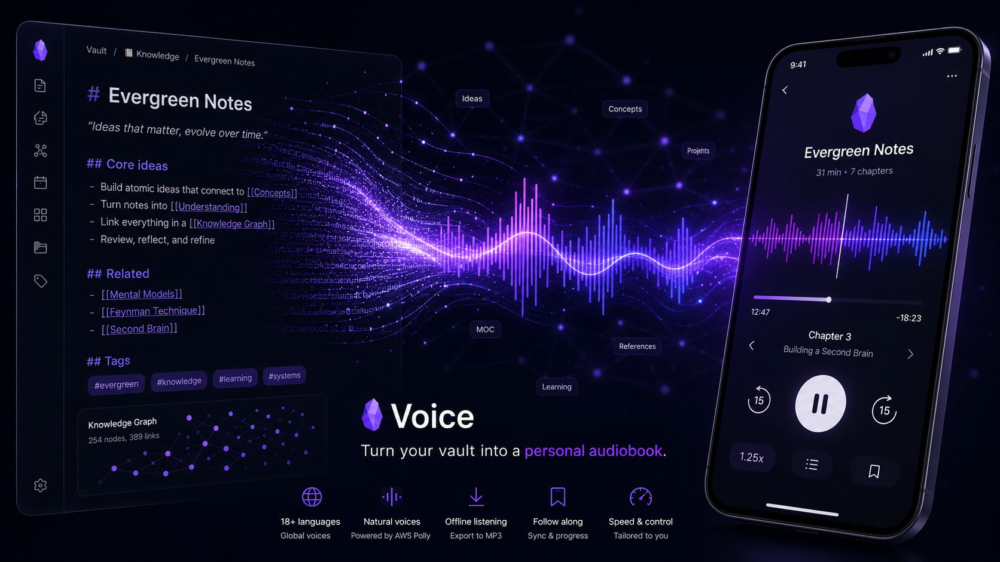
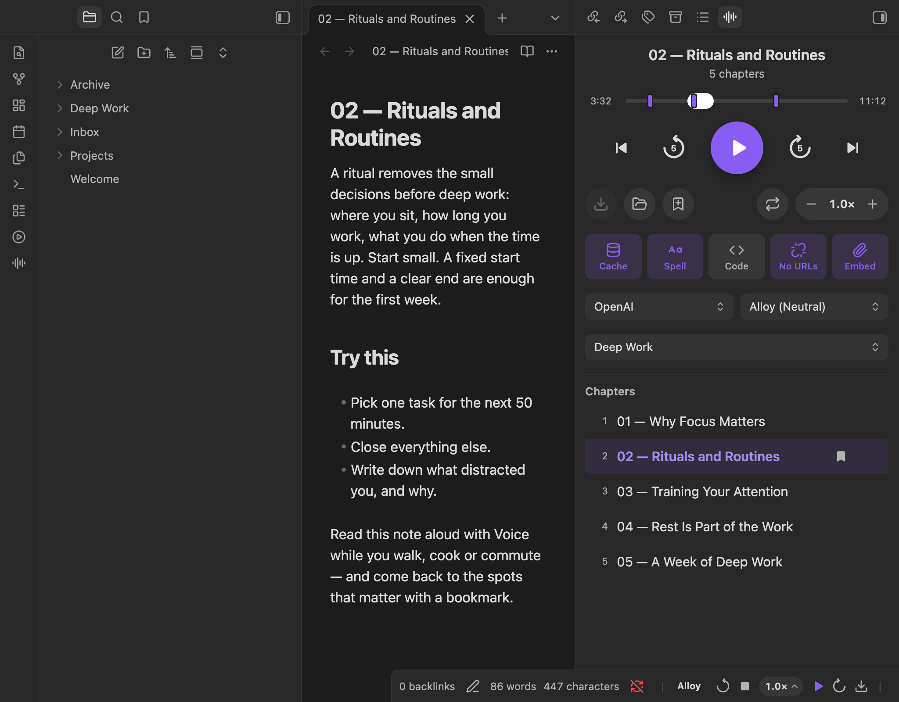
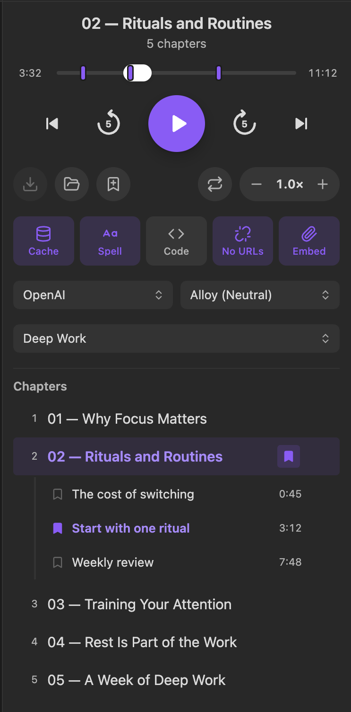
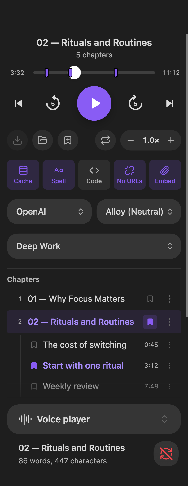

# Obsidian Voice 🔊

**Listen to your notes.** Voice reads your Obsidian notes aloud in natural, lifelike speech — with a player that feels like an audiobook app. Use the text-to-speech provider you already have: **OpenAI, ElevenLabs, AWS Polly, Google Cloud, Azure Speech, MiniMax** or any **OpenAI-compatible** server, even one running on your own computer.

**[📖 Read the User Guide](https://github.com/chrisurf/obsidian-voice/blob/main/docs/README.md)** · **[⚡ Get started in 5 minutes](https://github.com/chrisurf/obsidian-voice/blob/main/docs/getting-started/install.md)** · **[🆘 Help](https://github.com/chrisurf/obsidian-voice/blob/main/docs/help/troubleshooting.md)**

  

## What you can do with it

- 🚶 **Listen on the go.** Turn notes, articles and book summaries into audio for your walk, commute or workout — and save them as MP3s to play offline.
- 📚 **Study by ear.** Make your course notes a playlist of chapters, replay the hard parts at your own speed, and bookmark what you want to review.
- ✍️ **Proofread your writing.** Hearing a draft read aloud reveals clumsy sentences and typos your eyes skip over.
- 🌍 **Practice a language.** Hear vocabulary and texts spoken by native-sounding voices in dozens of languages, slower or faster.
- 👀 **Rest your eyes.** Let Voice read long notes to you when your eyes are tired — or whenever reading is hard.
- 🎧 **Build a personal podcast.** Save readings into a folder and play them back to back, like the episodes of a show.

## How it works

1. **Connect a provider** — paste your API key and test it. [Pick a provider →](https://github.com/chrisurf/obsidian-voice/blob/main/docs/providers/README.md)
2. **Press play** on any note. Long notes start playing after the first part, while the rest is generated.
3. **Keep what you like** — save it as an MP3, bookmark the key moments, listen again any time.

## Highlights

**An audiobook player for your vault.** Play, pause, skip, change the speed from 0.5× to 2.0×, and see your saved audio as chapters you can play back to back. [The Voice player →](https://github.com/chrisurf/obsidian-voice/blob/main/docs/using-voice/player.md)

**Bookmarks that travel with the file.** Mark a spot with one tap and jump back later. Bookmarks are stored inside the MP3, so they also show up as chapters in podcast apps. [Bookmarks →](https://github.com/chrisurf/obsidian-voice/blob/main/docs/using-voice/bookmarks.md)

  
  &nbsp;&nbsp;
  

**Own your audio.** Save readings as MP3s next to the note or in a folder of your choice, embed them in the note, and never pay twice for the same audio. [Saving audio →](https://github.com/chrisurf/obsidian-voice/blob/main/docs/using-voice/saving-audio.md)

**Reads the way your language is spoken.** Speech profiles handle acronyms, abbreviations, lists and pauses per language — English, German and French ship ready to use, and you can add your own. [Speech profiles →](https://github.com/chrisurf/obsidian-voice/blob/main/docs/customizing/speech-profiles.md)

**Desktop and mobile.** The same player on Windows, macOS, Linux, iPhone, iPad and Android, with a touch-friendly control bar. [On mobile →](https://github.com/chrisurf/obsidian-voice/blob/main/docs/using-voice/mobile.md)

**Keyboard friendly.** 18 commands you can bind to your own hotkeys. [Commands and shortcuts →](https://github.com/chrisurf/obsidian-voice/blob/main/docs/customizing/shortcuts.md)

**Private by design.** Your notes go straight from Obsidian to the provider you chose, with your own key. No account with us, no tracking.

## Providers

| Provider                                                                                                      | Good for                                             |
| ------------------------------------------------------------------------------------------------------------- | ---------------------------------------------------- |
| [OpenAI](https://github.com/chrisurf/obsidian-voice/blob/main/docs/providers/openai.md)                       | Natural multilingual voices with one API key         |
| [ElevenLabs](https://github.com/chrisurf/obsidian-voice/blob/main/docs/providers/elevenlabs.md)               | The most expressive voices                           |
| [AWS Polly](https://github.com/chrisurf/obsidian-voice/blob/main/docs/providers/aws-polly.md)                 | Many languages, generous free tier                   |
| [Google Cloud](https://github.com/chrisurf/obsidian-voice/blob/main/docs/providers/google-cloud.md)           | Neural2 and WaveNet voices                           |
| [Azure Speech](https://github.com/chrisurf/obsidian-voice/blob/main/docs/providers/azure-speech.md)           | Hundreds of voices, grouped by language              |
| [MiniMax](https://github.com/chrisurf/obsidian-voice/blob/main/docs/providers/minimax.md)                     | Chinese voices and a mainland-China region           |
| [OpenAI-compatible](https://github.com/chrisurf/obsidian-voice/blob/main/docs/providers/openai-compatible.md) | OpenRouter, LiteLLM or a free voice on your computer |

Every feature works the same with every provider, and you can switch at any time.

## Get started

1. In Obsidian, open **Settings → Community plugins → Browse**, search for **Voice**, install and enable it.
2. Open **Settings → Voice**, choose your provider, paste your key and select **Test Credentials**.
3. Open a note and press ▶️ in the Voice player.

The [User Guide](https://github.com/chrisurf/obsidian-voice/blob/main/docs/README.md) walks you through each step with pictures and covers every feature in depth.

## Help and feedback

- [Troubleshooting](https://github.com/chrisurf/obsidian-voice/blob/main/docs/help/troubleshooting.md) and [FAQ](https://github.com/chrisurf/obsidian-voice/blob/main/docs/help/faq.md)
- Found a bug or have an idea? [Open an issue](https://github.com/chrisurf/obsidian-voice/issues).

## Support

Voice is free and open source, built and maintained in my spare time. If it makes listening to your notes easier, you can support its development with a coffee — it's genuinely appreciated. ☕

