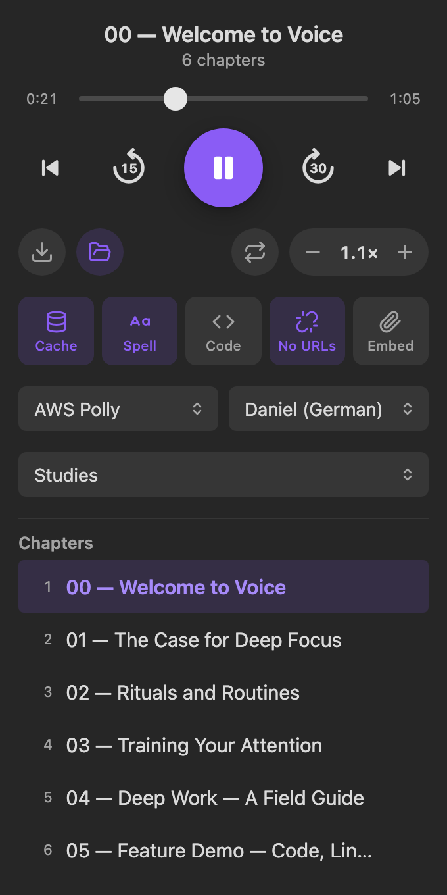
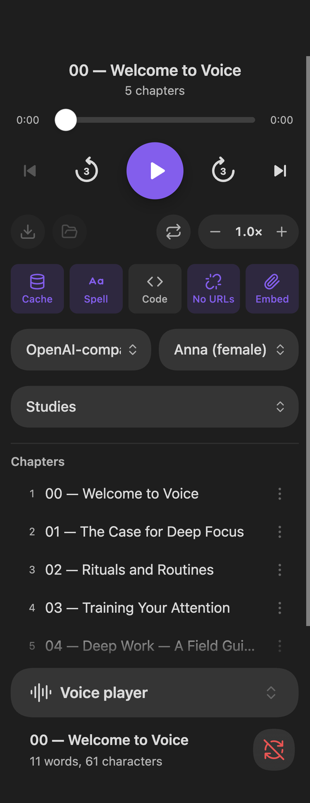
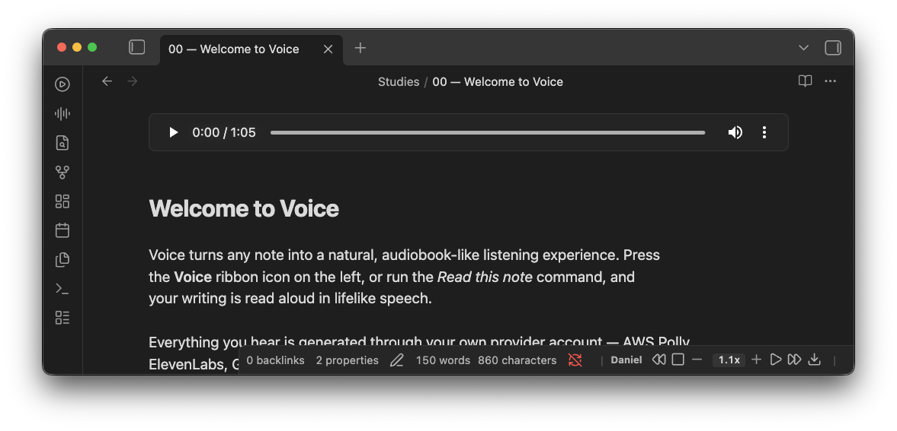
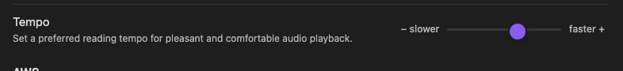
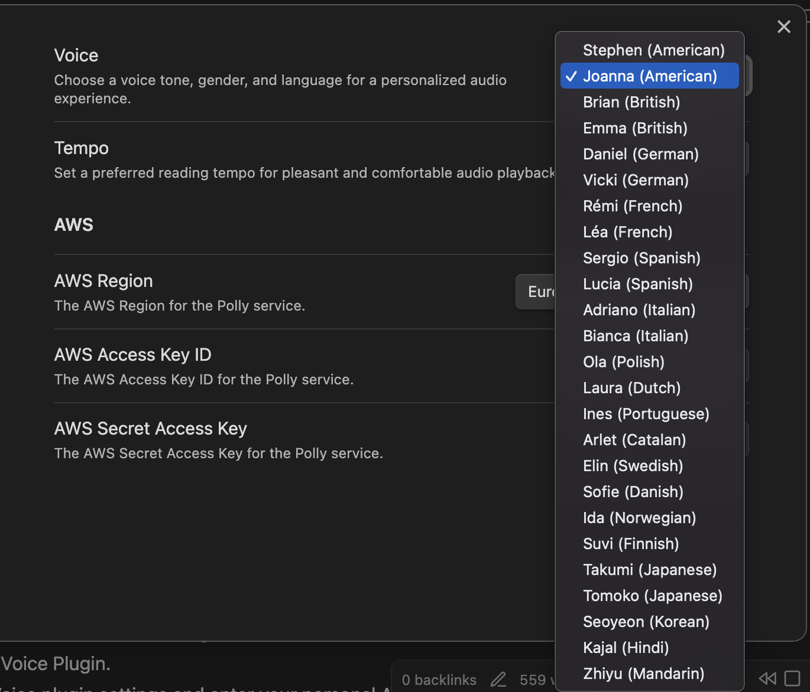
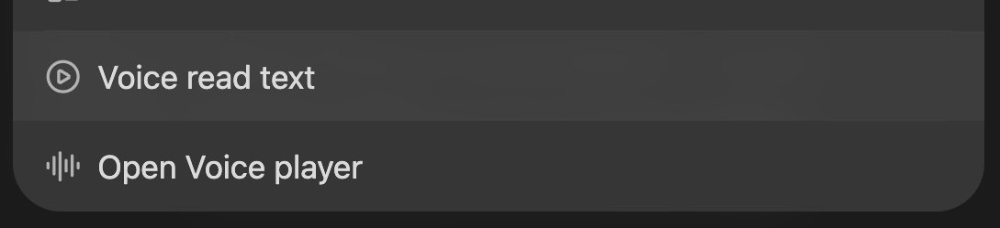
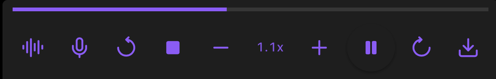
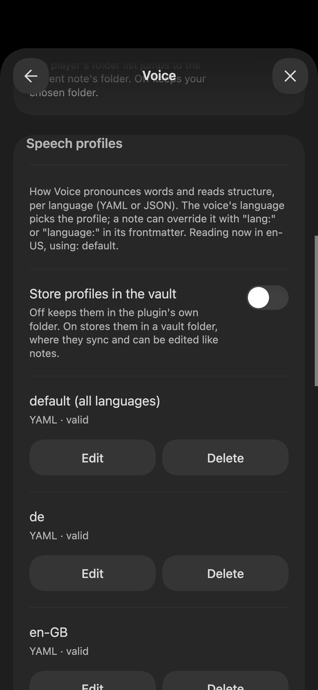
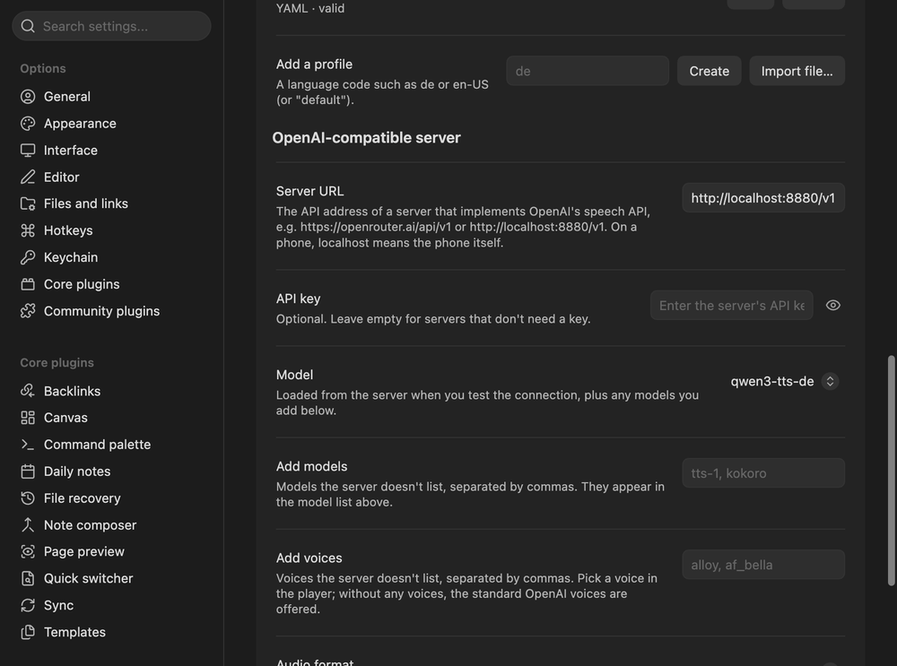

# Obsidian Voice Plugin 🔊


Turn every note into a mobile-friendly, audiobook-like experience. The Obsidian Voice Plugin reads your notes aloud in natural, lifelike speech — using the text-to-speech provider you already have. It supports all the major engines — **AWS Polly**, **ElevenLabs**, **OpenAI**, **Google Cloud**, **Azure Speech**, and **MiniMax** — plus **any OpenAI-compatible server** such as OpenRouter or a self-hosted Kokoro — so you can listen with whichever one you prefer. Listen with a dedicated player, jump between notes like chapters, change the speed on the fly, and save audio offline — with your credentials kept private in your own account.

<p align="center">
  <a href="https://www.buymeacoffee.com/chrisurf" target="_blank">
    
  </a>
</p>

## Table of Contents

- [Highlights](#highlights)
- [The Voice Player](#the-voice-player)
- [Feature Tour](#feature-tour)
- [Settings](#settings)
- [Keyboard Shortcuts](#keyboard-shortcuts)
- [Bring Your Own Provider](#bring-your-own-provider)
- [Getting Started](#getting-started)
- [Connecting a Provider](#connecting-a-provider)
- [Troubleshooting & Help](#troubleshooting--help)
- [Support](#support)

## Highlights

- **A real audiobook player** — open the Voice player, see your notes as chapters, and play, skip, and repeat just like a podcast app.
- **Bring your own provider** — Voice supports all the major text-to-speech engines (**AWS Polly**, **ElevenLabs**, **OpenAI**, **Google Cloud**, **Azure Speech**, and **MiniMax**) and any **OpenAI-compatible server**, so you can listen with whichever one you already use. Every feature works the same on all of them.
- **Listen in seconds** — turn any note into lifelike speech straight from the ribbon, a command, or the player.
- **Designed for every device** — the same look and controls on desktop, iPhone, iPad, and Android, on any Obsidian version, with a touch-friendly mobile player and control bar.
- **Own your audio** — download MP3 files, auto-embed them into your note, and keep an offline archive.
- **Stay in control** — adjust tempo on the fly, jump forward or back, repeat a chapter or the whole list, and with **Cache** never pay twice for the same note by accident.
- **Stay private** — your credentials live in your own provider account; nothing is routed through a third party.

## The Voice Player

The Voice player is the heart of the plugin: an audiobook-style pane that turns your notes into chapters you can listen to back to back. It's docked in the right sidebar (next to Backlinks and Outline) right after install — open it from the audio-waveform ribbon icon — and on mobile it opens full-screen.



#### Controls at a glance

| Control                                       | What it does                                                                                                            |
| --------------------------------------------- | ----------------------------------------------------------------------------------------------------------------------- |
| ▶️ **Play**                                   | Play, pause, or cancel a synthesis that's running                                                                       |
| ⏮ ⏭ **Prev / next**                         | Jump to the previous / next chapter                                                                                     |
| ↺ ↻ **Rewind / forward**                      | Jump back / ahead by your interval (shown inside the ring; default 3 s)                                                 |
| ⬇️ **Save** (💾 when a default folder is set) | **Tap:** save the MP3 — next to the note, or into your default folder. **Hold** (~1.5 s, or right-click): folder picker |
| 📂 **Folder**                                 | Save into a folder you pick, in one click                                                                               |
| 🔁 **Repeat**                                 | Cycle _off → repeat one → repeat all_                                                                                   |
| **− 1.0× +** **Speed**                        | Slow down / speed up playback (0.5×–2.0×)                                                                               |
| ⋮ **Track menu**                              | **Move / Rename / Delete** that chapter                                                                                 |

Below them sits a row of **toggles** that light up when on:

| Toggle      | On                                                                                      | Default |
| ----------- | --------------------------------------------------------------------------------------- | ------- |
| **Cache**   | ▶️ reuses the note's existing audio instead of generating it again (see below)          | on      |
| **Spell**   | Spell out acronyms — read `NASA`, `API` letter by letter                                | off     |
| **Code**    | Read fenced code blocks (Mermaid, YAML, …) aloud instead of a short placeholder         | off     |
| **No URLs** | Skip website URLs (`https://…`, `www.…`); link labels and the surrounding text are kept | off     |
| **Embed**   | Add an audio player to the note whenever you save its MP3                               | off     |

**Spell**, **Code** and **No URLs** are stored in your [speech profile](#speech-profiles-how-voice-reads), so they follow the language you're listening in.

#### Cache: never pay twice by accident

- **Cache on** (default): ▶️ plays the note's **existing audio** — its saved MP3, or the audio already generated this session — and only generates when there is none yet. Changing the voice or a toggle does **not** generate new audio on its own.
- **Cache off**: the next ▶️ **generates the note again** with your current voice and settings (a new, paid request to your provider). Afterwards Cache switches itself **back on**.

So to hear a note with a new voice or new settings: turn **Cache** off, then press ▶️ — even if the old recording is paused mid-way, it is generated anew. With Cache on, pausing and resuming never generates anything.

Above the chapter list sit the **provider** and **voice** dropdowns (switch engine or voice instantly) and a **folder dropdown** that points the chapter list at any folder in your vault that contains audio.

- **Chapters from your folder** — every MP3 in the selected folder appears as a numbered chapter; the one you're hearing is highlighted. The folder list follows the note you're viewing by default — turn off **Folder list follows note** in settings to keep your chosen folder while you browse.
- **Manage tracks** — the **⋮** action bar appears right over the track, so it's clear which file it acts on. **Move** opens the folder picker for that file, **Rename** edits it in place (`.mp3` kept, embeds updated), and **Delete** asks for a quick confirmation.

On mobile, the same player opens as a full-screen pane, optimized for touch:



> **Tip:** Open the player from the **Open Voice player** ribbon icon (the audio-waveform icon) or the **Open the player.** command.

## Feature Tour

### Listen Instantly

- Two **ribbon icons on the left** get you going: **Voice read text** (▶️) starts reading the active note, and **Open Voice player** (the audio-waveform icon) opens the player.

  

- Default playback reads the entire note. In Source mode, select text first and only your selection is read.
- The **Voice read text** icon shows a refresh indicator while synthesizing and flips to a pause icon when playback is ready.

### Save & Play Audio Offline

The **save button** (the download arrow ⬇, in the player, the status bar, and the mobile bar) writes the current audio to an MP3, embeds it right after the front matter, and adds it to the chapter list — so you can replay it anytime, offline. It has **two gestures**:

- 👆 **Tap** → save now. By default the MP3 lands **next to your note**. If you've set a **default folder**, every tap saves there instead.
- ✋ **Press and hold ~1.5 seconds** (or right-click on desktop) → open the **folder picker** to save somewhere else just this once — or to set your default folder.

In the Voice player there's also a dedicated **folder button** (📂, next to the download arrow): one click opens the folder picker and saves to the folder you choose — a quick **Save to custom folder** without the long press.



**Set a default folder (optional).** In the folder picker, every folder row has a **pin** 📌 and a **star** ⭐:

- 📌 **Pin** → make this folder your default. From now on a quick tap of the save button always saves here. Only one default at a time — tap the pin again to clear it (back to “next to the note”). The default is shown first and highlighted.
- ⭐ **Star** → keep a folder near the top as a favorite. Favorites and the default are managed independently.
- Start typing to filter the list, or to **create a new folder** on the spot.

> **Example.** You keep recordings in `Media/Audio`. Hold the save button, then tap the **pin 📌** next to `Media/Audio`. Done — now a single tap of the save button always stores there. Need to drop one file elsewhere? Hold again and tap a different folder; your default stays put.

**Save or move, your choice.** When you pick a folder in the picker:

- If the audio hasn't been saved yet, it's **saved** into that folder.
- If you loaded an existing recording (a **chapter** in the player), that file is **moved** into the folder — no duplicate, and its embeds are updated automatically.
- If a file with the same name is already there, a prompt lets you **Replace**, **Save as new** (a different name), or **Cancel**.

> **Tip:** When a default folder is set, the save button shows a **floppy-disk** icon (💾) — in the player, the status bar, and the mobile bar — so you can tell at a glance that a tap saves into your default folder rather than next to the note.

- Prefer a hands-off workflow? Turn on **Save automatically** in settings to save and embed after every playback (it uses your default folder too).
- With **Cache** on (the default), audio you already generated or saved is reused instead of paying for it again — see [Cache](#cache-never-pay-twice-by-accident).

### Precision Playback Controls

- Track synthesis progress with the real-time status bar indicator until playback is ready.

  

- Use rewind / fast-forward and on-the-fly speed changes for quick navigation — from the player or the status bar.
- Set how far rewind and fast-forward jump — configure each independently from 1 to 60 seconds in settings (defaults to 3 seconds).
- **Speed on the fly** — nudge playback with the player's **− / +** control (0.5×–2.0×) or from the status bar; hotkeys can also jump to preset tempos.

  

### Personalize the Voice

- **Pick your voice in the player** — choose from dozens of natural voices across many languages: American, British, German, French, Spanish, Italian, Polish, Dutch, Portuguese, Brazilian Portuguese, Catalan, Swedish, Danish, Norwegian, Finnish, Japanese, Korean, Hindi, Mandarin, and more.

  

- Switch voices instantly from the player's voice dropdown or the status bar, or use the **Switch to the next speaker.** command to cycle through them hands-free.
- **Azure: every voice, grouped by language.** Press **Test Credentials** in settings and Voice loads your account's full Azure neural catalog (hundreds of voices), organized by language in the picker — no more being limited to a handful.

### Built for Mobile

- On the Obsidian mobile app, start playback or open the player from the dedicated **Voice read text** and **Open Voice player** menu items.

  

- Control playback with the touch-friendly mobile control bar — open the player, switch voice, rewind, stop, tempo, play / pause, fast-forward, save, and a progress indicator. (It stays out of the way while the full player is open.)

  

- Update credentials, validate your setup, and check voice availability directly from mobile settings.

  

### Speech Profiles: How Voice Reads

A **speech profile** decides how Voice reads in one language: how words are pronounced, what is read at all, and how a note's structure sounds. Voice ships sensible defaults (with German and English built in), and you change only what you want.

- **Per language.** A profile per language (`de`, `en-US`, …) plus an optional **default** for every language without its own. The voice's language picks the profile; a note can override it with `lang:` or `language:` in its frontmatter.
- **Pronunciation.** A lexicon says what to say instead of a word — `KI` → "Ka-I", a name, a brand. German abbreviations (`z. B.`, `d. h.`, `usw.`, `Dr.`) and acronyms (`KI`, `EU`, `API`) are built in.
- **Structure.** Pauses after headings and between paragraphs and list items; numbered lists read as "Erstens, …", as numbers, or not at all; wrapped lines inside a paragraph are joined, so Voice never stops mid-sentence.
- **YAML or JSON.** Voice detects the format. Edit a profile in **Settings → Voice → Speech profiles** — with quick controls for every setting, or as text — paste one in, or import a file.
- **Where they live.** In the plugin's folder by default; turn on **Store profiles in the vault** to keep them in a vault folder, where they sync and can be edited like notes.
- **Versioned.** Each file starts with `voiceProfile: 1`. A newer format is refused with a clear message instead of being misread, and settings a version doesn't know are kept but not applied.

```yaml
voiceProfile: 1
language: de
lexicon:
  - match: KI
    say: Ka-I
  - match: Obsidian
    say: Obsidjen
content:
  acronyms: word # word | spell
  codeBlocks: placeholder # placeholder | read
  urls: skip # read | skip
structure:
  headings:
    pause: 800ms
  lists:
    numbering: ordinal # ordinal | number | none
```

The full list of settings, with what each does, is in the template Voice creates when you add a profile. Headings, bold text, and pauses are additionally emphasized natively on providers that support SSML (AWS Polly, Google Cloud, Azure Speech).

## Settings

Configure your provider and credentials in **Settings → Voice**. The settings tab stays lean: it covers setup and defaults, while the things you change while listening — **voice**, **tempo**, and the **toggles** (Cache, Spell, Code, No URLs, Embed) — live as one-click controls in the Voice player.



| Setting                      | What it does                                                                                                                                                                                                 |
| ---------------------------- | ------------------------------------------------------------------------------------------------------------------------------------------------------------------------------------------------------------ |
| **Speech Provider**          | Choose the engine: **AWS Polly**, **ElevenLabs**, **Google Cloud**, **Azure Speech**, **OpenAI**, **OpenAI-compatible**, or **MiniMax**. The credential fields below adapt to your choice.                   |
| **Rewind interval**          | How many seconds the rewind control jumps back (1–60s, default 3s).                                                                                                                                          |
| **Fast-forward interval**    | How many seconds the fast-forward control jumps ahead (1–60s, default 3s).                                                                                                                                   |
| **Save automatically**       | Automatically save and embed the MP3 after each playback. Off by default.                                                                                                                                    |
| **Save location**            | Where saved MP3s go. Next to the note by default. Hold the save button to open the folder picker, then pin (📌) a folder as your default; tap the pin again to clear it. Star (⭐) folders for quick access. |
| **Speech profiles**          | How Voice reads, per language — see [Speech Profiles](#speech-profiles-how-voice-reads). Edit, paste, import, or delete profiles; optionally store them in a vault folder.                                   |
| **Folder list follows note** | Player's folder picker auto-switches to the folder of the note you're viewing. On by default; turn off to keep your chosen folder.                                                                           |
| **Test Credentials**         | Validate your provider keys; on success it reports how many voices are available.                                                                                                                            |

## Keyboard Shortcuts

Voice ships **16 commands** you can bind to any hotkey. No keys are assigned by default — open **Settings → Hotkeys**, search for **Voice**, and assign whatever feels natural. (In the command palette, each command is prefixed with **Voice:**.)

| Command                                                                   | What it does                             |
| ------------------------------------------------------------------------- | ---------------------------------------- |
| Start reading the current document.                                       | Begin reading the active note            |
| Play or Stop reading the current document.                                | Toggle playback with one key             |
| Pause reading the current document.                                       | Pause playback                           |
| Stop reading the current document.                                        | Stop playback and reset                  |
| Rewind by few seconds reading the current document.                       | Jump back by your rewind interval        |
| Fast-Forward by few seconds reading the current document.                 | Jump ahead by your fast-forward interval |
| Increase the reading speed by 0.1x.                                       | Speed up playback                        |
| Decrease the reading speed by 0.1x.                                       | Slow down playback                       |
| Reading tempo increased by 15% for a faster pace of the current document. | Read at 1.15×                            |
| Reading tempo increased by 25% for a faster pace of the current document. | Read at 1.25×                            |
| Reading tempo reduced by 15% for a slower pace of the current document.   | Read at 0.85×                            |
| Reading tempo reduced by 25% for a slower pace of the current document.   | Read at 0.75×                            |
| Save the current audio as an MP3 and embed it in the note.                | Download and embed the audio             |
| Switch to the next speaker.                                               | Cycle to the next voice                  |
| Open the player.                                                          | Open the Voice player pane               |
| Show what's new.                                                          | Reopen the latest "What's New" note      |

## Bring Your Own Provider

Voice is built to work with the provider you already use. For a long time it was AWS Polly only — the goal now is to support all the common text-to-speech engines, so you can bring your own. Pick **AWS Polly**, **ElevenLabs**, **OpenAI**, **Google Cloud**, **Azure Speech**, **MiniMax**, or **OpenAI-compatible** from the **Speech Provider** dropdown in settings. Each provider keeps its own credentials and voice list; everything else — tempo, rewind/fast-forward intervals, downloads, auto-save, and the player toggles — works identically. After entering your credentials, press **Test Credentials** to confirm everything is connected.

The newest addition, **MiniMax**, adds a selectable **mainland-China region** and strong Chinese-language voices — so Voice now works even where the other engines are hard to reach.

|                 | **AWS Polly**                       | **ElevenLabs**                                      | **Google Cloud**                                  | **Azure Speech**                    | **OpenAI**                                    | **MiniMax**                                    |
| --------------- | ----------------------------------- | --------------------------------------------------- | ------------------------------------------------- | ----------------------------------- | --------------------------------------------- | ---------------------------------------------- |
| **Voices**      | Neural voices across many languages | Premade & multilingual voices speaking 29 languages | Neural2 & WaveNet voices across many languages    | Neural voices across many languages | Built-in multilingual voices (Alloy, Nova, …) | Multilingual voices, strong Chinese support    |
| **Credentials** | AWS region + Access Key ID & Secret | ElevenLabs API key                                  | Google Cloud API key (Text-to-Speech API enabled) | Azure Speech key + region           | OpenAI API key                                | MiniMax API key + Group ID (region-selectable) |
| **Emphasis**    | Native SSML pauses & emphasis       | Expressive models with natural `<break>` pauses     | Native SSML pauses & emphasis                     | Native SSML pauses & emphasis       | Natural prosody (no SSML)                     | Natural prosody (no SSML)                      |
| **Models**      | Neural engine                       | Multilingual v2 / Flash v2.5 / Turbo v2.5           | Neural2 / WaveNet                                 | Neural                              | GPT-4o mini TTS / TTS-1 / TTS-1 HD            | Speech 02 HD/Turbo · Speech 01 HD/Turbo        |

## Getting Started

1. Install the Voice plugin inside Obsidian (Community Plugins → Browse → Voice) and toggle it on.
2. Open **Settings → Voice** and pick your **Speech Provider**.
3. Enter that provider's credentials (see [Connecting a Provider](#connecting-a-provider)) and press **Test Credentials**.
4. Open any note and press the Voice ribbon icon — or open the player — to start listening.
5. Not working? See [Troubleshooting & Help](#troubleshooting--help).

## Connecting a Provider

Start with the provider you already have — you can switch anytime.

**AWS Polly** — In **Settings → Voice**, choose **AWS Polly**, select your region, paste your **Access Key ID** and **Secret Access Key**, and press **Test Credentials**. For a step-by-step guide to creating a dedicated AWS key, see [Advanced: AWS Polly Setup](./TROUBLESHOOTING.md#advanced-aws-polly-setup).

**ElevenLabs** — Sign in at [elevenlabs.io](https://elevenlabs.io/), open **Settings → API Keys**, and create a key. In **Settings → Voice**, choose **ElevenLabs**, pick a model and voice, paste the key, and press **Test Credentials**.

**Google Cloud** — In the [Google Cloud console](https://console.cloud.google.com/), enable the **Cloud Text-to-Speech API** and create an **API key**. In **Settings → Voice**, choose **Google Cloud**, pick a voice, paste the key, and press **Test Credentials**. (Don't add an HTTP-referrer restriction — see the [provider notes](./TROUBLESHOOTING.md#provider-specific-notes).)

**Azure Speech** — In the [Azure portal](https://portal.azure.com/), create a **Speech** resource and copy a **Key** and **Region**. In **Settings → Voice**, choose **Azure Speech**, select the matching region, pick a voice, paste the key, and press **Test Credentials**.

**OpenAI** — Create an API key at [platform.openai.com/api-keys](https://platform.openai.com/api-keys). In **Settings → Voice**, choose **OpenAI**, pick a model and voice, paste the key, and press **Test Credentials**.

**OpenAI-compatible** — Any server that speaks OpenAI's speech API. See [OpenAI-compatible servers](#openai-compatible-servers) below.

**MiniMax** — Sign in at [platform.minimax.io](https://platform.minimax.io/) (or [platform.minimaxi.com](https://platform.minimaxi.com/) for mainland China) and copy your **API key** and **Group ID**. In **Settings → Voice**, choose **MiniMax**, select the matching **region**, pick a model and voice, paste the key and Group ID, and press **Test Credentials**.

### OpenAI-compatible servers

Many services and self-hosted servers offer the same speech API as OpenAI. Choose **OpenAI-compatible** as the provider to use one of them, next to the regular OpenAI provider — both keep their own settings, so you can switch between them in the player.

1. Enter the **Server URL** — the address the API paths hang off, for example:

   | Server                                                             | Server URL                     |
   | ------------------------------------------------------------------ | ------------------------------ |
   | [OpenRouter](https://openrouter.ai/)                               | `https://openrouter.ai/api/v1` |
   | [Kokoro-FastAPI](https://github.com/remsky/Kokoro-FastAPI) (local) | `http://localhost:8880/v1`     |
   | [LiteLLM](https://docs.litellm.ai/) proxy (local)                  | `http://localhost:4000/v1`     |

   The URL is used exactly as entered; Voice appends `/audio/speech` and `/models` to it.

2. Paste an **API key** if the server needs one (OpenRouter does; most local servers don't).
3. Press **Test Credentials**. Voice connects and loads the server's **models** and, where the server publishes them, its **voices**.
4. Pick a **Model**. If the server doesn't list the model or voice you want, type it into **Add models** or **Add voices** (comma-separated). Without any voices, the standard OpenAI voices (Alloy, Nova, …) are offered.
5. Choose the **voice** in the player.

**Audio format.** MP3 is the default and works everywhere. Switch **Audio format** to **WAV** for servers that only produce WAV — saved files then end in `.wav` and show up in the chapter list like MP3s.

**Security.** Prefer `https://` with a real certificate (Let's Encrypt, a Tailscale cert); self-signed certificates are not supported. Plain `http://` sends your notes unencrypted and may be blocked by the operating system, especially on iOS — only use it on a network you trust.

**On mobile**, `localhost` means the phone itself, so a server running on your computer isn't reachable that way. Use an address the phone can reach — your computer's network address or a hosted HTTPS server.

## Troubleshooting & Help

Run into an error, see a red control bar, or need the advanced provider setup (like creating a dedicated AWS user or picking the best region)? Everything is collected in the **[Troubleshooting & Advanced Setup guide](./TROUBLESHOOTING.md)**.

## Support

Voice is free and open source, built and maintained in my spare time. If it makes listening to your notes easier, you can support continued development with a coffee — it's genuinely appreciated. ☕

[](https://buymeacoffee.com/chrisurf)

You'll also find a **Sponsor** button at the top of the [GitHub repository](https://github.com/chrisurf/obsidian-voice) and a donate link on the plugin's page inside Obsidian.
