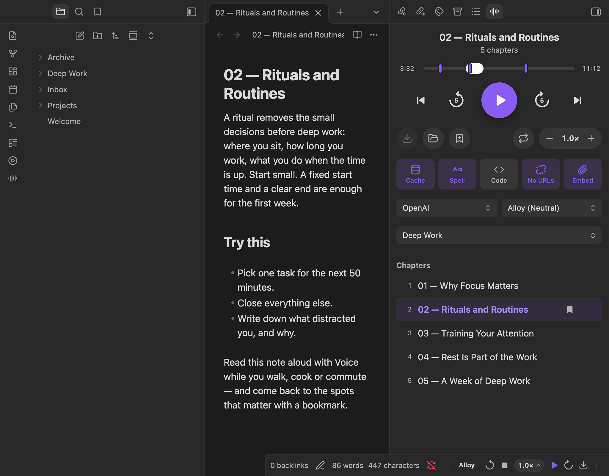

<!-- guide:header -->

**[🏠 User Guide](https://github.com/chrisurf/obsidian-voice/blob/main/docs/README.md)** · [Getting started](https://github.com/chrisurf/obsidian-voice/blob/main/docs/getting-started/README.md) · [Providers](https://github.com/chrisurf/obsidian-voice/blob/main/docs/providers/README.md) · [Using Voice](https://github.com/chrisurf/obsidian-voice/blob/main/docs/using-voice/README.md) · [Customizing](https://github.com/chrisurf/obsidian-voice/blob/main/docs/customizing/README.md) · [Help](https://github.com/chrisurf/obsidian-voice/blob/main/docs/help/README.md)

📍 **User Guide**

<!-- /guide:header -->

# Obsidian Voice — User Guide

Voice reads your Obsidian notes aloud in natural, lifelike speech, using the text-to-speech provider you already have. This guide shows you every feature, step by step and with pictures — from installing the plugin to bookmarks, speech profiles and keyboard shortcuts.

## Where to start

- **New to Voice?** Begin with [Install Voice](https://github.com/chrisurf/obsidian-voice/blob/main/docs/getting-started/install.md), then [connect a provider](https://github.com/chrisurf/obsidian-voice/blob/main/docs/getting-started/connect-a-provider.md) and play [your first reading](https://github.com/chrisurf/obsidian-voice/blob/main/docs/getting-started/first-reading.md). It takes about five minutes.
- **Setting up a provider?** Every provider has its own page under [Providers](https://github.com/chrisurf/obsidian-voice/blob/main/docs/providers/README.md).
- **Already listening?** [The Voice player](https://github.com/chrisurf/obsidian-voice/blob/main/docs/using-voice/player.md) explains every control; [Bookmarks](https://github.com/chrisurf/obsidian-voice/blob/main/docs/using-voice/bookmarks.md) and [Saving audio](https://github.com/chrisurf/obsidian-voice/blob/main/docs/using-voice/saving-audio.md) show the most useful features.
- **Something not working?** See [Troubleshooting](https://github.com/chrisurf/obsidian-voice/blob/main/docs/help/troubleshooting.md).

## Contents

<!-- guide:toc -->

### [Getting started](https://github.com/chrisurf/obsidian-voice/blob/main/docs/getting-started/README.md)

Install Voice, connect a provider and hear your first note.

- [Install Voice](https://github.com/chrisurf/obsidian-voice/blob/main/docs/getting-started/install.md) — Install and enable the plugin, find the player and the ribbon icons.
- [Connect a provider](https://github.com/chrisurf/obsidian-voice/blob/main/docs/getting-started/connect-a-provider.md) — Pick a text-to-speech provider, enter your key and test the connection.
- [Your first reading](https://github.com/chrisurf/obsidian-voice/blob/main/docs/getting-started/first-reading.md) — Read a note aloud, follow the progress and save the audio.

### [Providers](https://github.com/chrisurf/obsidian-voice/blob/main/docs/providers/README.md)

Step-by-step setup for every supported text-to-speech provider.

- [AWS Polly](https://github.com/chrisurf/obsidian-voice/blob/main/docs/providers/aws-polly.md) — Neural voices in many languages, with a dedicated, minimal AWS key.
- [ElevenLabs](https://github.com/chrisurf/obsidian-voice/blob/main/docs/providers/elevenlabs.md) — Expressive, multilingual voices and models for quality or speed.
- [OpenAI](https://github.com/chrisurf/obsidian-voice/blob/main/docs/providers/openai.md) — Natural multilingual voices such as Alloy and Nova.
- [Google Cloud](https://github.com/chrisurf/obsidian-voice/blob/main/docs/providers/google-cloud.md) — Neural2 and WaveNet voices with an API key.
- [Azure Speech](https://github.com/chrisurf/obsidian-voice/blob/main/docs/providers/azure-speech.md) — Hundreds of neural voices, loaded from your Azure account.
- [MiniMax](https://github.com/chrisurf/obsidian-voice/blob/main/docs/providers/minimax.md) — Multilingual voices with strong Chinese support and a mainland-China region.
- [OpenAI-compatible servers](https://github.com/chrisurf/obsidian-voice/blob/main/docs/providers/openai-compatible.md) — OpenRouter, LiteLLM or a voice running on your own computer.

### [Using Voice](https://github.com/chrisurf/obsidian-voice/blob/main/docs/using-voice/README.md)

Everything you do while listening: the player, chapters, bookmarks and saving.

- [The Voice player](https://github.com/chrisurf/obsidian-voice/blob/main/docs/using-voice/player.md) — A tour of every control in the player.
- [Reading notes aloud](https://github.com/chrisurf/obsidian-voice/blob/main/docs/using-voice/listening.md) — Whole notes or a selection, long notes that start early, and the Cache toggle.
- [Speed, skipping and repeat](https://github.com/chrisurf/obsidian-voice/blob/main/docs/using-voice/playback-controls.md) — Change the tempo, jump back or ahead, and repeat chapters.
- [Chapters](https://github.com/chrisurf/obsidian-voice/blob/main/docs/using-voice/chapters.md) — Your saved audio as a playlist: play, move, rename and delete tracks.
- [Bookmarks](https://github.com/chrisurf/obsidian-voice/blob/main/docs/using-voice/bookmarks.md) — Mark a spot while you listen and jump back to it later.
- [Saving audio](https://github.com/chrisurf/obsidian-voice/blob/main/docs/using-voice/saving-audio.md) — Save MP3s, choose folders, set a default folder and embed audio in notes.
- [Status bar controls](https://github.com/chrisurf/obsidian-voice/blob/main/docs/using-voice/status-bar.md) — Control playback from the bottom of the window on desktop.
- [On iPhone, iPad and Android](https://github.com/chrisurf/obsidian-voice/blob/main/docs/using-voice/mobile.md) — The full-screen player and the control bar on mobile.

### [Customizing](https://github.com/chrisurf/obsidian-voice/blob/main/docs/customizing/README.md)

Make Voice read the way you like and fit your workflow.

- [Voices and languages](https://github.com/chrisurf/obsidian-voice/blob/main/docs/customizing/voices-and-languages.md) — Choose and switch voices, and how the language is picked.
- [Speech profiles](https://github.com/chrisurf/obsidian-voice/blob/main/docs/customizing/speech-profiles.md) — How Voice reads acronyms, abbreviations, lists and pauses, per language.
- [Settings](https://github.com/chrisurf/obsidian-voice/blob/main/docs/customizing/settings.md) — Every setting explained.
- [Commands and shortcuts](https://github.com/chrisurf/obsidian-voice/blob/main/docs/customizing/shortcuts.md) — All commands, and how to give them your own hotkeys.

### [Help](https://github.com/chrisurf/obsidian-voice/blob/main/docs/help/README.md)

Fix problems and find answers.

- [Troubleshooting](https://github.com/chrisurf/obsidian-voice/blob/main/docs/help/troubleshooting.md) — Quick fixes, error messages and common problems.
- [FAQ](https://github.com/chrisurf/obsidian-voice/blob/main/docs/help/faq.md) — Costs, privacy, offline listening, sync and file formats.

<!-- /guide:toc -->

<!-- guide:footer -->

---

<table><tr>
<td></td>
<td align="right">Next → <a href="https://github.com/chrisurf/obsidian-voice/blob/main/docs/getting-started/README.md"><b>Getting started</b></a></td>
</tr></table>

<!-- /guide:footer -->
