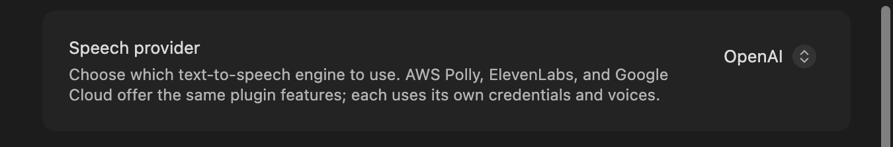
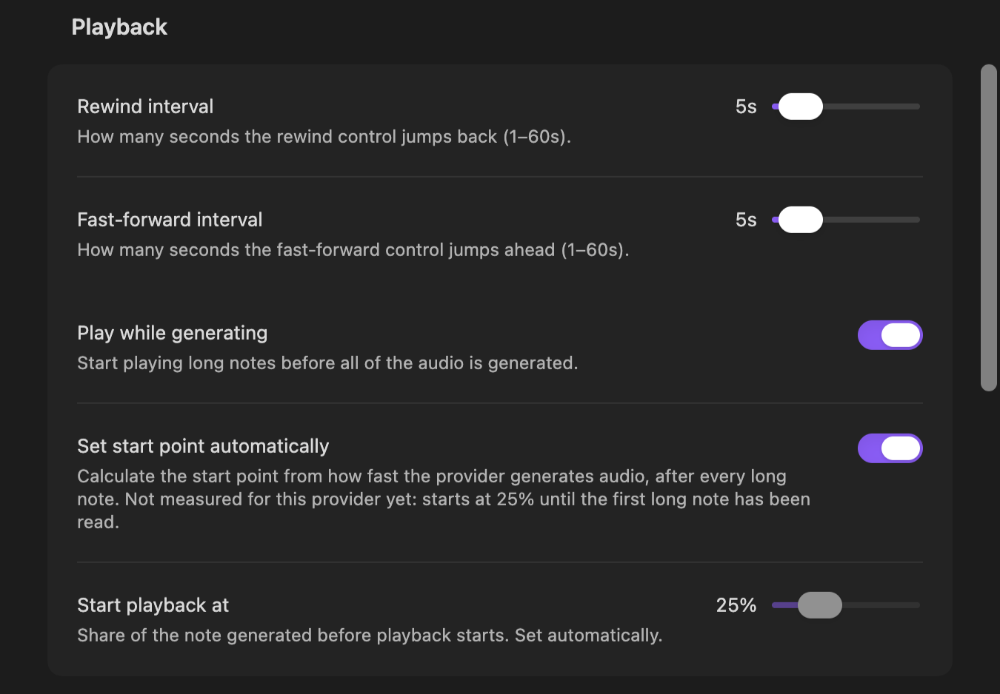
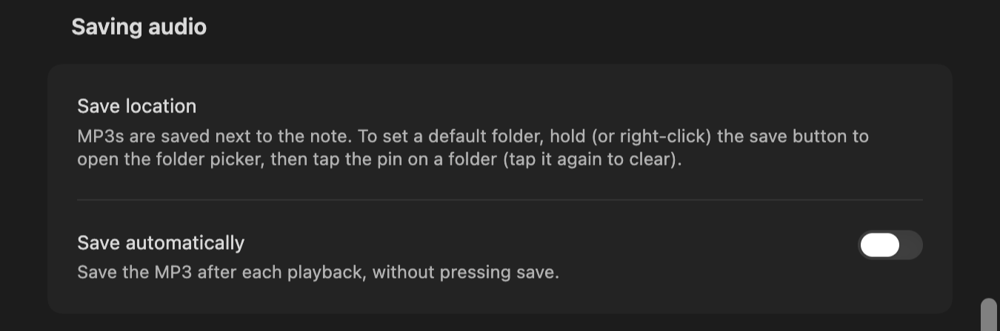
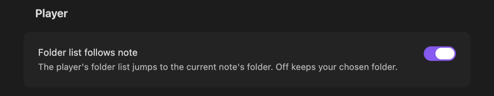

<!-- guide:header -->

[🏠 User Guide](https://github.com/chrisurf/obsidian-voice/blob/main/docs/README.md) · [Getting started](https://github.com/chrisurf/obsidian-voice/blob/main/docs/getting-started/README.md) · [Providers](https://github.com/chrisurf/obsidian-voice/blob/main/docs/providers/README.md) · [Using Voice](https://github.com/chrisurf/obsidian-voice/blob/main/docs/using-voice/README.md) · **[Customizing](https://github.com/chrisurf/obsidian-voice/blob/main/docs/customizing/README.md)** · [Help](https://github.com/chrisurf/obsidian-voice/blob/main/docs/help/README.md)

📍 [User Guide](https://github.com/chrisurf/obsidian-voice/blob/main/docs/README.md) › [Customizing](https://github.com/chrisurf/obsidian-voice/blob/main/docs/customizing/README.md) › **Settings**

<!-- /guide:header -->

# Settings

Open **Settings → Voice**. The settings cover setup and defaults; what you change while listening — voice, speed and the toggles — lives in the [player](https://github.com/chrisurf/obsidian-voice/blob/main/docs/using-voice/player.md).

## Speech provider

Choose the engine. The credentials for it appear further down; see [Providers](https://github.com/chrisurf/obsidian-voice/blob/main/docs/providers/README.md).

## Playback

| Setting                           | What it does                                                                                                   | Default |
| --------------------------------- | -------------------------------------------------------------------------------------------------------------- | ------- |
| **Rewind interval**               | How far ↺ jumps back (1–60 seconds)                                                                            | 5 s     |
| **Fast-forward interval**         | How far ↻ jumps ahead (1–60 seconds)                                                                           | 5 s     |
| **Play while generating**         | Start playing long notes before they are fully generated                                                       | on      |
| **Set start point automatically** | Voice decides when to start, from the provider's measured speed                                                | on      |
| **Start playback at**             | With the automatic start point off: how much of the note is generated before playback starts (0% = first part) | 25%     |

## Saving audio

| Setting                | What it does                                                                          | Default          |
| ---------------------- | ------------------------------------------------------------------------------------- | ---------------- |
| **Save location**      | Shows where MP3s are saved. Set a default folder with the pin 📌 in the folder picker | next to the note |
| **Save automatically** | Save every reading after it plays, without pressing save                              | off              |

See [Saving audio](https://github.com/chrisurf/obsidian-voice/blob/main/docs/using-voice/saving-audio.md).

## Player

| Setting                      | What it does                                                        | Default |
| ---------------------------- | ------------------------------------------------------------------- | ------- |
| **Folder list follows note** | The player's folder jumps to the folder of the note you are viewing | on      |

## Speech profiles

How Voice reads, per language. See [Speech profiles](https://github.com/chrisurf/obsidian-voice/blob/main/docs/customizing/speech-profiles.md).

## Provider credentials

The fields for the chosen provider: keys, region, model and — for OpenAI-compatible servers — the server address. **Test Credentials** checks them. See the page of your provider under [Providers](https://github.com/chrisurf/obsidian-voice/blob/main/docs/providers/README.md).

<!-- guide:footer -->

---

<table><tr>
<td align="left">← Previous <a href="https://github.com/chrisurf/obsidian-voice/blob/main/docs/customizing/speech-profiles.md"><b>Speech profiles</b></a></td>
<td align="right">Next → <a href="https://github.com/chrisurf/obsidian-voice/blob/main/docs/customizing/shortcuts.md"><b>Commands and shortcuts</b></a></td>
</tr></table>

<!-- /guide:footer -->
