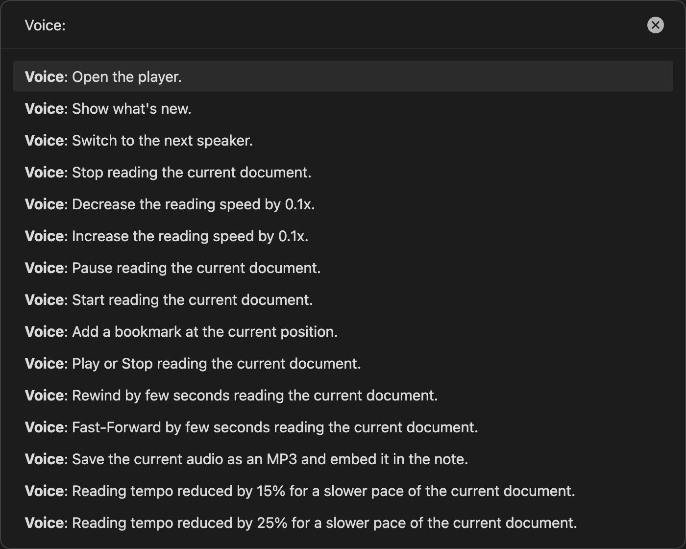
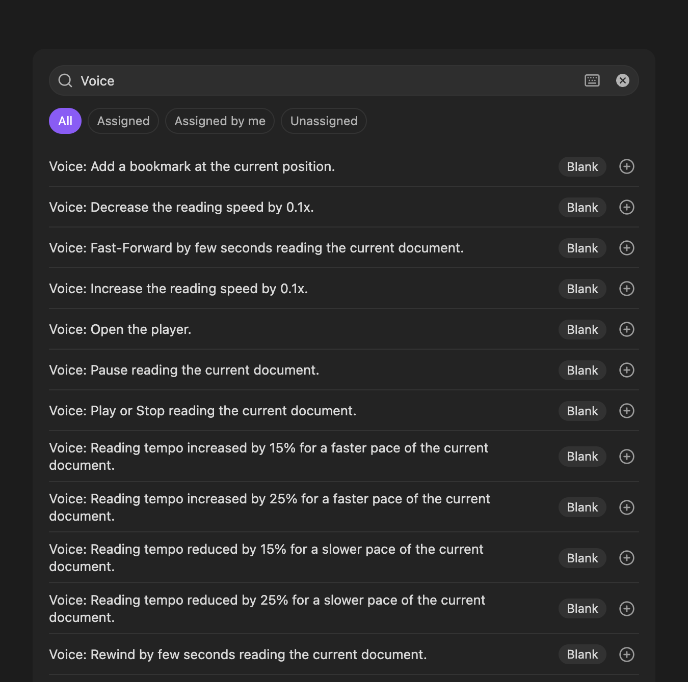

<!-- guide:header -->

[🏠 User Guide](https://github.com/chrisurf/obsidian-voice/blob/main/docs/README.md) · [Getting started](https://github.com/chrisurf/obsidian-voice/blob/main/docs/getting-started/README.md) · [Providers](https://github.com/chrisurf/obsidian-voice/blob/main/docs/providers/README.md) · [Using Voice](https://github.com/chrisurf/obsidian-voice/blob/main/docs/using-voice/README.md) · **[Customizing](https://github.com/chrisurf/obsidian-voice/blob/main/docs/customizing/README.md)** · [Help](https://github.com/chrisurf/obsidian-voice/blob/main/docs/help/README.md)

📍 [User Guide](https://github.com/chrisurf/obsidian-voice/blob/main/docs/README.md) › [Customizing](https://github.com/chrisurf/obsidian-voice/blob/main/docs/customizing/README.md) › **Commands and shortcuts**

<!-- /guide:header -->

# Commands and shortcuts

Everything Voice does is also a **command**. Run commands from the command palette, or give them your own keyboard shortcuts.

## The command palette

Press `Ctrl+P` (`Cmd+P` on a Mac) and type **Voice:**

## Give a command a hotkey

Voice doesn't assign keys by default, so it never clashes with your own. To add one:

1. Open **Settings → Hotkeys**.
2. Search for **Voice**.
3. Select ⊕ next to a command and press the keys you want.

A good start: one key for _Play or Stop_, one for _Add a bookmark_, and two for _Rewind_ and _Fast-Forward_.

## All commands

| Command                                                                   | What it does                      |
| ------------------------------------------------------------------------- | --------------------------------- |
| Start reading the current document.                                       | Read the note you are viewing     |
| Play or Stop reading the current document.                                | Start or stop with one key        |
| Pause reading the current document.                                       | Pause                             |
| Stop reading the current document.                                        | Stop and go back to the start     |
| Stop generating audio (asks first).                                       | Cancel the note being generated   |
| Add a bookmark at the current position.                                   | Bookmark the spot you're hearing  |
| Rewind by few seconds reading the current document.                       | Jump back (5 seconds by default)  |
| Fast-Forward by few seconds reading the current document.                 | Jump ahead (5 seconds by default) |
| Increase the reading speed by 0.1x.                                       | Faster                            |
| Decrease the reading speed by 0.1x.                                       | Slower                            |
| Reading tempo increased by 15% for a faster pace of the current document. | Play at 1.15×                     |
| Reading tempo increased by 25% for a faster pace of the current document. | Play at 1.25×                     |
| Reading tempo reduced by 15% for a slower pace of the current document.   | Play at 0.85×                     |
| Reading tempo reduced by 25% for a slower pace of the current document.   | Play at 0.75×                     |
| Save the current audio as an MP3 and embed it in the note.                | Save the audio                    |
| Switch to the next speaker.                                               | Next voice                        |
| Open the player.                                                          | Open the Voice player             |
| Show what's new.                                                          | Open the latest "What's new" note |

<!-- guide:footer -->

---

<table><tr>
<td align="left">← Previous <a href="https://github.com/chrisurf/obsidian-voice/blob/main/docs/customizing/settings.md"><b>Settings</b></a></td>
<td align="right">Next → <a href="https://github.com/chrisurf/obsidian-voice/blob/main/docs/help/README.md"><b>Help</b></a></td>
</tr></table>

<!-- /guide:footer -->
