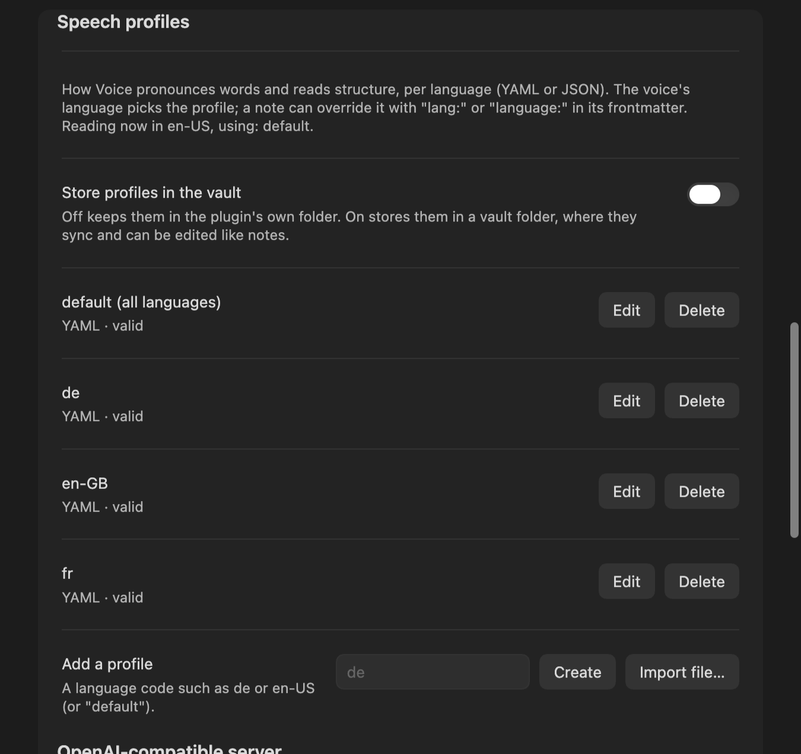
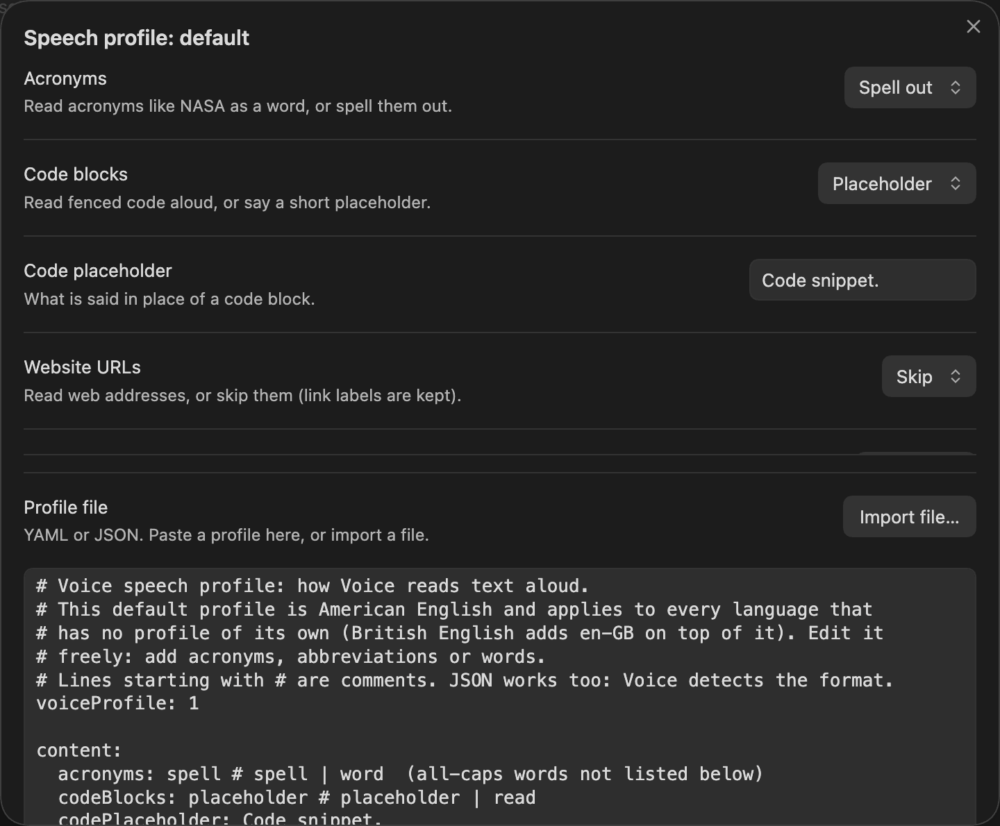

<!-- guide:header -->

[🏠 User Guide](https://github.com/chrisurf/obsidian-voice/blob/main/docs/README.md) · [Getting started](https://github.com/chrisurf/obsidian-voice/blob/main/docs/getting-started/README.md) · [Providers](https://github.com/chrisurf/obsidian-voice/blob/main/docs/providers/README.md) · [Using Voice](https://github.com/chrisurf/obsidian-voice/blob/main/docs/using-voice/README.md) · **[Customizing](https://github.com/chrisurf/obsidian-voice/blob/main/docs/customizing/README.md)** · [Help](https://github.com/chrisurf/obsidian-voice/blob/main/docs/help/README.md)

📍 [User Guide](https://github.com/chrisurf/obsidian-voice/blob/main/docs/README.md) › [Customizing](https://github.com/chrisurf/obsidian-voice/blob/main/docs/customizing/README.md) › **Speech profiles**

<!-- /guide:header -->

# Speech profiles

A **speech profile** decides how Voice reads in one language: which acronyms are spelled out, how abbreviations are said, how lists and headings sound, and how special words are pronounced. Profiles are simple text files (YAML or JSON) you can read and change.

## The profiles that ship with Voice

Four profiles are created the first time Voice starts:

| Profile     | Used for                                                        |
| ----------- | --------------------------------------------------------------- |
| **default** | Every language without its own profile (American English rules) |
| **en-GB**   | British English — only what differs from the default            |
| **de**      | German                                                          |
| **fr**      | French                                                          |

Profiles add up: a German voice (`de-DE`) uses _default_, then _de_, then _de-DE_ if it exists. Add a profile for any other language in settings.

## Manage profiles

Open **Settings → Voice → Speech profiles**:



- **Edit** opens a profile.
- **Delete** removes it.
- **Add a profile**: type a language code such as `es` or `en-US` and select **Create** — or **Import file…** to load one.
- **Store profiles in the vault** keeps them in a vault folder (`Voice/Profiles` by default), where they sync and can be edited like notes. Otherwise they live in the plugin's folder.

## Edit a profile

The editor shows quick controls for every setting at the top and the full text of the profile below. Change either — they stay in sync. You can also paste a whole profile.



The player's **Spell**, **Code** and **No URLs** toggles change the profile of the language you're listening in.

## What you can set

**Acronyms.** A comma-separated list of acronyms to **spell** letter by letter (`API, CEO, EU`), and words to **say** in a particular way (`JSON: jay-son`). Plurals like "APIs" are included. Upper and lower case matter: `IT` is spelled, `it` is not.

**Abbreviations** as `written: spoken` pairs, for example `e.g.: for example` or `z. B.: zum Beispiel`. End the spoken form with a dot to keep the sentence's full stop: `etc.: et cetera.`

**Structure.** Pauses after headings and between paragraphs and list items. Numbered lists can be read with words ("First, … Second, …"), as numbers, or without numbering. Lines wrapped inside a paragraph are joined, so Voice never pauses mid-sentence.

**Content.** Whether code blocks are read or replaced by a placeholder (and what the placeholder says), and whether web addresses are skipped.

**Lexicon.** Special pronunciations, for example a name the voice gets wrong.

## An example

```yaml
voiceProfile: 1
language: de

acronyms:
  spell: >-
    KI, IT, EU, API, URL, PDF
  say:
    JSON: Dschäisen

abbreviations:
  z. B.: zum Beispiel
  usw.: und so weiter.

structure:
  lists:
    ordinals: Erstens, Zweitens, Drittens

lexicon:
  - match: Obsidian
    say: Obsidjen
    caseSensitive: false
```

Every setting is explained in the comments of the shipped profiles and of the template Voice creates when you add a profile.

## Good to know

- Each file starts with `voiceProfile: 1`. A file in a newer format is refused with a clear message rather than misread.
- With AWS Polly, Google Cloud and Azure Speech, headings and emphasis additionally get native pauses and stress (SSML).

<!-- guide:footer -->

---

<table><tr>
<td align="left">← Previous<br><a href="https://github.com/chrisurf/obsidian-voice/blob/main/docs/customizing/voices-and-languages.md"><b>Voices and languages</b></a></td>
<td align="right">Next →<br><a href="https://github.com/chrisurf/obsidian-voice/blob/main/docs/customizing/settings.md"><b>Settings</b></a></td>
</tr></table>

<!-- /guide:footer -->
