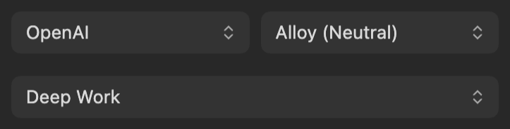
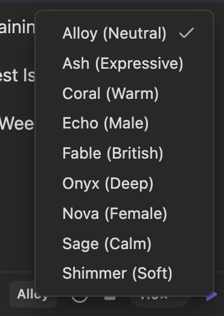

<!-- guide:header -->

[🏠 User Guide](https://github.com/chrisurf/obsidian-voice/blob/main/docs/README.md) · [Getting started](https://github.com/chrisurf/obsidian-voice/blob/main/docs/getting-started/README.md) · [Providers](https://github.com/chrisurf/obsidian-voice/blob/main/docs/providers/README.md) · [Using Voice](https://github.com/chrisurf/obsidian-voice/blob/main/docs/using-voice/README.md) · **[Customizing](https://github.com/chrisurf/obsidian-voice/blob/main/docs/customizing/README.md)** · [Help](https://github.com/chrisurf/obsidian-voice/blob/main/docs/help/README.md)

📍 [User Guide](https://github.com/chrisurf/obsidian-voice/blob/main/docs/README.md) › [Customizing](https://github.com/chrisurf/obsidian-voice/blob/main/docs/customizing/README.md) › **Voices and languages**

<!-- /guide:header -->

# Voices and languages

## Choose a voice

Pick a voice in the player's **voice** picker, right under the toggles. The list shows the voices of the provider you selected; switch the provider in the picker next to it.

On desktop you can also click the voice name in the status bar:

The command _Switch to the next speaker._ cycles through the voices — handy with a [hotkey](https://github.com/chrisurf/obsidian-voice/blob/main/docs/customizing/shortcuts.md).

A new voice is used for the **next** reading. To hear a note you've already generated with the new voice, turn **Cache** off and press ▶️ (see [Cache](https://github.com/chrisurf/obsidian-voice/blob/main/docs/using-voice/listening.md#cache-never-pay-twice-by-accident)).

## Voices in many languages

Depending on the provider, you can choose from dozens to hundreds of voices: English (US and UK), German, French, Spanish, Italian, Dutch, Polish, Portuguese, Swedish, Danish, Norwegian, Finnish, Japanese, Korean, Hindi, Mandarin and many more.

- **OpenAI, ElevenLabs, MiniMax** and most OpenAI-compatible servers have multilingual voices that follow the language of the text.
- **AWS Polly, Google Cloud** and **Azure Speech** voices each speak one language. Pick one that matches your note.
- **Azure** loads every voice of your account, grouped by language, when you select **Test Credentials**.

## How Voice picks the language

The language decides which [speech profile](https://github.com/chrisurf/obsidian-voice/blob/main/docs/customizing/speech-profiles.md) is used — how acronyms, abbreviations and lists are read:

1. A note can set its language in its front matter: `lang: de` or `language: fr-FR`.
2. Otherwise, the voice's language is used (for example `de-DE` for a German voice).

<!-- guide:footer -->

---

<table><tr>
<td align="left">← Previous <a href="https://github.com/chrisurf/obsidian-voice/blob/main/docs/customizing/README.md"><b>Customizing</b></a></td>
<td align="right">Next → <a href="https://github.com/chrisurf/obsidian-voice/blob/main/docs/customizing/speech-profiles.md"><b>Speech profiles</b></a></td>
</tr></table>

<!-- /guide:footer -->
