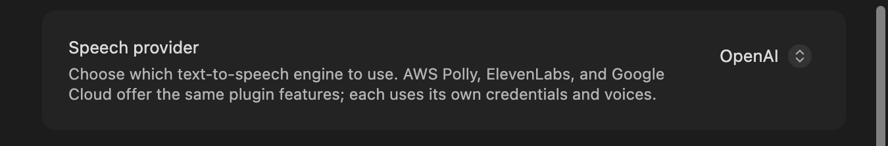
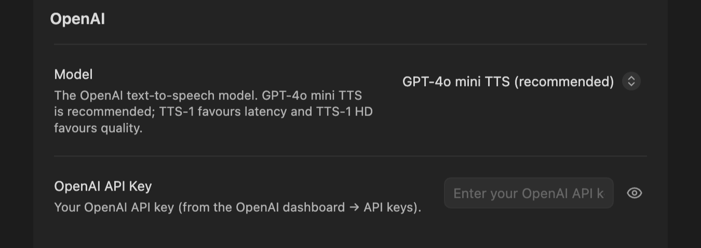

<!-- guide:header -->

[🏠 User Guide](https://github.com/chrisurf/obsidian-voice/blob/main/docs/README.md) · **[Getting started](https://github.com/chrisurf/obsidian-voice/blob/main/docs/getting-started/README.md)** · [Providers](https://github.com/chrisurf/obsidian-voice/blob/main/docs/providers/README.md) · [Using Voice](https://github.com/chrisurf/obsidian-voice/blob/main/docs/using-voice/README.md) · [Customizing](https://github.com/chrisurf/obsidian-voice/blob/main/docs/customizing/README.md) · [Help](https://github.com/chrisurf/obsidian-voice/blob/main/docs/help/README.md)

📍 [User Guide](https://github.com/chrisurf/obsidian-voice/blob/main/docs/README.md) › [Getting started](https://github.com/chrisurf/obsidian-voice/blob/main/docs/getting-started/README.md) › **Connect a provider**

<!-- /guide:header -->

# Connect a provider

Voice doesn't generate speech itself — it sends your note to a **text-to-speech provider** of your choice and plays the audio it returns. You use your own account, so your key and your notes never pass through anyone else.

## 1. Choose a provider

Open **Settings → Voice** and pick one in **Speech provider**. The fields below it change to match your choice.

| If you…                                      | Try                                                                                                                                                                                                                                                                                                     |
| -------------------------------------------- | ------------------------------------------------------------------------------------------------------------------------------------------------------------------------------------------------------------------------------------------------------------------------------------------------------- |
| want great voices with little setup          | [OpenAI](https://github.com/chrisurf/obsidian-voice/blob/main/docs/providers/openai.md) or [ElevenLabs](https://github.com/chrisurf/obsidian-voice/blob/main/docs/providers/elevenlabs.md)                                                                                                              |
| already use AWS, Google Cloud or Azure       | [AWS Polly](https://github.com/chrisurf/obsidian-voice/blob/main/docs/providers/aws-polly.md), [Google Cloud](https://github.com/chrisurf/obsidian-voice/blob/main/docs/providers/google-cloud.md), [Azure Speech](https://github.com/chrisurf/obsidian-voice/blob/main/docs/providers/azure-speech.md) |
| need strong Chinese voices or a China region | [MiniMax](https://github.com/chrisurf/obsidian-voice/blob/main/docs/providers/minimax.md)                                                                                                                                                                                                               |
| want to run a voice on your own computer     | [OpenAI-compatible servers](https://github.com/chrisurf/obsidian-voice/blob/main/docs/providers/openai-compatible.md)                                                                                                                                                                                   |

The [provider overview](https://github.com/chrisurf/obsidian-voice/blob/main/docs/providers/README.md) compares all of them. You can switch at any time — every feature works the same with every provider.

## 2. Enter your key

Each provider asks for its own credentials, usually an **API key**. The provider pages explain where to find it, step by step. For example, OpenAI needs just one key:

> **Tip:** The 👁 button next to a key field shows or hides what you typed.

## 3. Test the connection

Select **Test Credentials** below the fields. A confirmation tells you Voice is connected (and, for most providers, how many voices are available). If it fails, check the key and region, and see [Troubleshooting](https://github.com/chrisurf/obsidian-voice/blob/main/docs/help/troubleshooting.md).

## Next step

You're ready to listen: [Your first reading](https://github.com/chrisurf/obsidian-voice/blob/main/docs/getting-started/first-reading.md).

<!-- guide:footer -->

---

<table><tr>
<td align="left">← Previous <a href="https://github.com/chrisurf/obsidian-voice/blob/main/docs/getting-started/install.md"><b>Install Voice</b></a></td>
<td align="right">Next → <a href="https://github.com/chrisurf/obsidian-voice/blob/main/docs/getting-started/first-reading.md"><b>Your first reading</b></a></td>
</tr></table>

<!-- /guide:footer -->
