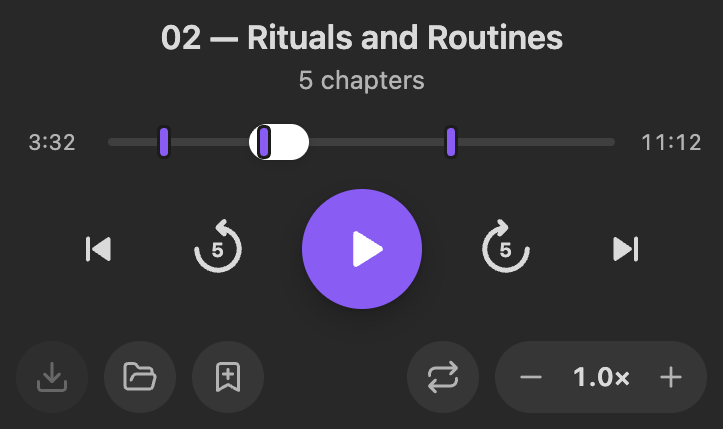
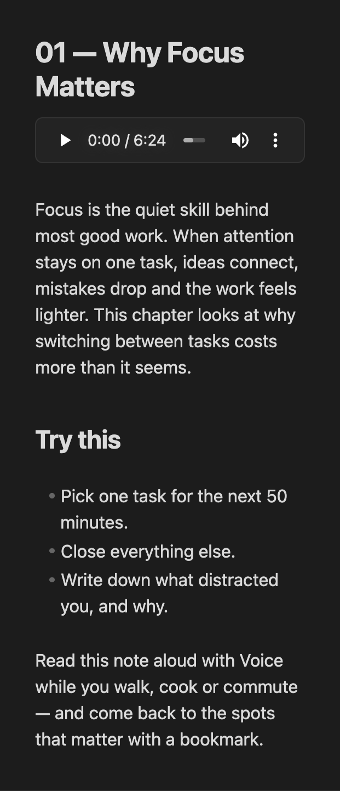

<!-- guide:header -->

[🏠 User Guide](https://github.com/chrisurf/obsidian-voice/blob/main/docs/README.md) · **[Getting started](https://github.com/chrisurf/obsidian-voice/blob/main/docs/getting-started/README.md)** · [Providers](https://github.com/chrisurf/obsidian-voice/blob/main/docs/providers/README.md) · [Using Voice](https://github.com/chrisurf/obsidian-voice/blob/main/docs/using-voice/README.md) · [Customizing](https://github.com/chrisurf/obsidian-voice/blob/main/docs/customizing/README.md) · [Help](https://github.com/chrisurf/obsidian-voice/blob/main/docs/help/README.md)

📍 [User Guide](https://github.com/chrisurf/obsidian-voice/blob/main/docs/README.md) › [Getting started](https://github.com/chrisurf/obsidian-voice/blob/main/docs/getting-started/README.md) › **Your first reading**

<!-- /guide:header -->

# Your first reading

## Read a note aloud

1. Open any note.
2. Select the ▶️ **Voice read text** icon in the left ribbon — or the big ▶️ button in the Voice player.

Voice turns the note into speech and starts playing. While it works, the ring around the play button fills up:

Long notes start playing **before** they are finished — after the first part — and the rest is generated while you listen. See [Reading notes aloud](https://github.com/chrisurf/obsidian-voice/blob/main/docs/using-voice/listening.md) for the details.

> **Only want part of a note?** Select the text first (in editing mode), then start reading. Voice reads only your selection.

## Control playback

The player works like a podcast app:

- ▶️ plays and pauses.
- ↺ and ↻ jump back and ahead by 5 seconds (you can [change that](https://github.com/chrisurf/obsidian-voice/blob/main/docs/customizing/settings.md)).
- **− 1.0× +** changes the speed from 0.5× to 2.0×.

[The Voice player](https://github.com/chrisurf/obsidian-voice/blob/main/docs/using-voice/player.md) explains every control.

## Keep the audio

Select the **save** button (⬇) to store the reading as an MP3 next to your note. It then appears as a **chapter** in the player, and you can listen again any time — offline and without paying for it twice.

With the **Embed** toggle on, Voice also adds an audio player to the note, as above. See [Saving audio](https://github.com/chrisurf/obsidian-voice/blob/main/docs/using-voice/saving-audio.md).

## Where to go next

- Mark a spot to come back to: [Bookmarks](https://github.com/chrisurf/obsidian-voice/blob/main/docs/using-voice/bookmarks.md).
- Pick a voice and language: [Voices and languages](https://github.com/chrisurf/obsidian-voice/blob/main/docs/customizing/voices-and-languages.md).
- Control Voice from the keyboard: [Commands and shortcuts](https://github.com/chrisurf/obsidian-voice/blob/main/docs/customizing/shortcuts.md).

<!-- guide:footer -->

---

<table><tr>
<td align="left">← Previous <a href="https://github.com/chrisurf/obsidian-voice/blob/main/docs/getting-started/connect-a-provider.md"><b>Connect a provider</b></a></td>
<td align="right">Next → <a href="https://github.com/chrisurf/obsidian-voice/blob/main/docs/providers/README.md"><b>Providers</b></a></td>
</tr></table>

<!-- /guide:footer -->
