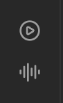
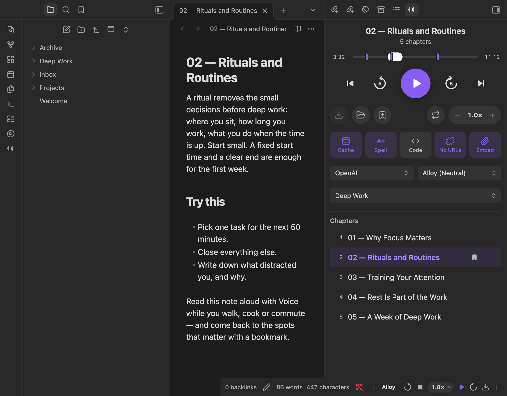
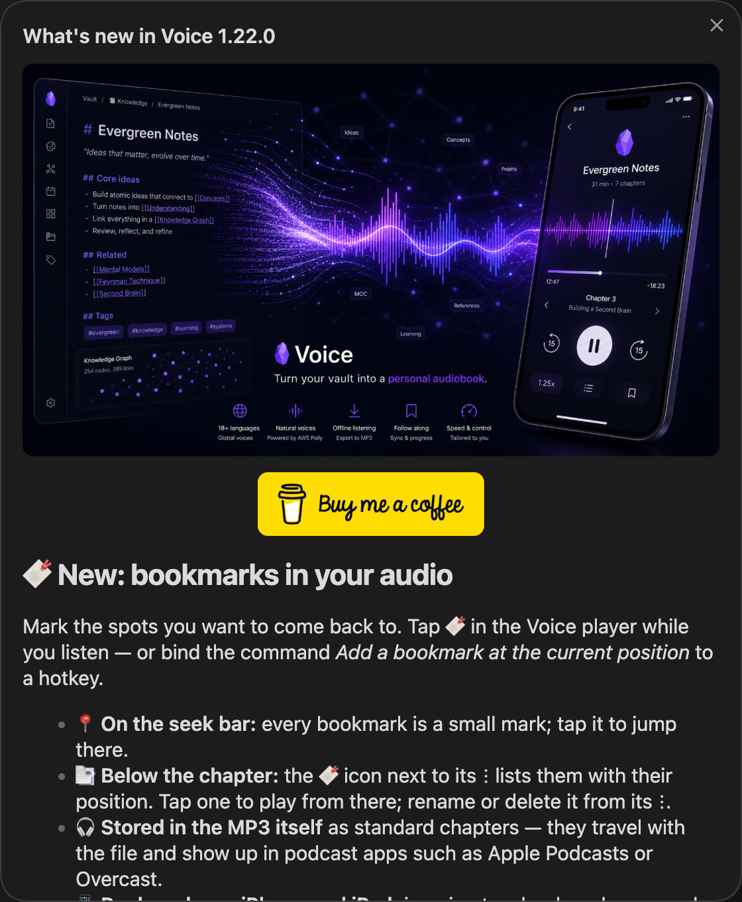

<!-- guide:header -->

[🏠 User Guide](https://github.com/chrisurf/obsidian-voice/blob/main/docs/README.md) · **[Getting started](https://github.com/chrisurf/obsidian-voice/blob/main/docs/getting-started/README.md)** · [Providers](https://github.com/chrisurf/obsidian-voice/blob/main/docs/providers/README.md) · [Using Voice](https://github.com/chrisurf/obsidian-voice/blob/main/docs/using-voice/README.md) · [Customizing](https://github.com/chrisurf/obsidian-voice/blob/main/docs/customizing/README.md) · [Help](https://github.com/chrisurf/obsidian-voice/blob/main/docs/help/README.md)

📍 [User Guide](https://github.com/chrisurf/obsidian-voice/blob/main/docs/README.md) › [Getting started](https://github.com/chrisurf/obsidian-voice/blob/main/docs/getting-started/README.md) › **Install Voice**

<!-- /guide:header -->

# Install Voice

## Install the plugin

1. In Obsidian, open **Settings → Community plugins**.
2. If you haven't used community plugins yet, select **Turn on community plugins**.
3. Select **Browse**, search for **Voice**, and select **Install**.
4. Select **Enable**.

That's it. Voice works on desktop (Windows, macOS, Linux) and on mobile (iPhone, iPad, Android).

## What you'll find after installing

**Two icons in the left ribbon.** The ▶️ icon (**Voice read text**) reads the note you are viewing; the waveform icon (**Open Voice player**) opens the player.

**The Voice player** opens in the right sidebar, next to Backlinks and Outline. It is your audiobook-style control center: play, skip, change the speed, switch voices and see your saved audio as chapters.

**Controls in the status bar** at the bottom of the window (desktop only): rewind, stop, speed, play and fast-forward. See [Status bar controls](https://github.com/chrisurf/obsidian-voice/blob/main/docs/using-voice/status-bar.md).

**A "What's new" note** greets you after each update, with the latest features. You can open it again any time with the command _Show what's new._

> **On mobile**, the player opens full screen and a touch-friendly control bar appears while you listen. See [On iPhone, iPad and Android](https://github.com/chrisurf/obsidian-voice/blob/main/docs/using-voice/mobile.md).

## Next step

Voice needs a text-to-speech provider to turn your notes into speech. Continue with [Connect a provider](https://github.com/chrisurf/obsidian-voice/blob/main/docs/getting-started/connect-a-provider.md).

<!-- guide:footer -->

---

<table><tr>
<td align="left">← Previous <a href="https://github.com/chrisurf/obsidian-voice/blob/main/docs/getting-started/README.md"><b>Getting started</b></a></td>
<td align="right">Next → <a href="https://github.com/chrisurf/obsidian-voice/blob/main/docs/getting-started/connect-a-provider.md"><b>Connect a provider</b></a></td>
</tr></table>

<!-- /guide:footer -->
