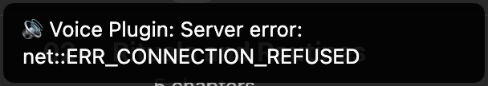

<!-- guide:header -->

[🏠 User Guide](https://github.com/chrisurf/obsidian-voice/blob/main/docs/README.md) · [Getting started](https://github.com/chrisurf/obsidian-voice/blob/main/docs/getting-started/README.md) · [Providers](https://github.com/chrisurf/obsidian-voice/blob/main/docs/providers/README.md) · [Using Voice](https://github.com/chrisurf/obsidian-voice/blob/main/docs/using-voice/README.md) · [Customizing](https://github.com/chrisurf/obsidian-voice/blob/main/docs/customizing/README.md) · **[Help](https://github.com/chrisurf/obsidian-voice/blob/main/docs/help/README.md)**

📍 [User Guide](https://github.com/chrisurf/obsidian-voice/blob/main/docs/README.md) › [Help](https://github.com/chrisurf/obsidian-voice/blob/main/docs/help/README.md) › **Troubleshooting**

<!-- /guide:header -->

# Troubleshooting

## Quick fixes

Most problems are solved by one of these:

1. **Test your credentials.** Open **Settings → Voice** and select **Test Credentials**. A confirmation means you're connected.
2. **Check your internet connection.** Speech is generated online by your provider (unless you run a [server of your own](https://github.com/chrisurf/obsidian-voice/blob/main/docs/providers/openai-compatible.md)).
3. **Open a note.** Voice reads the note in the active pane.
4. **Restart Obsidian** after installing or updating the plugin.

## Messages and the red bar

While Voice works, a progress bar fills in the [status bar](https://github.com/chrisurf/obsidian-voice/blob/main/docs/using-voice/status-bar.md) (desktop) or the [control bar](https://github.com/chrisurf/obsidian-voice/blob/main/docs/using-voice/mobile.md) (mobile). When something goes wrong, the bar turns red for a moment:

and a notice at the top explains what happened:

Everything resets after a few seconds — fix the cause and press ▶️ again.

## Common problems

| Problem                                       | Likely cause                                        | What to do                                                                                                                                                    |
| --------------------------------------------- | --------------------------------------------------- | ------------------------------------------------------------------------------------------------------------------------------------------------------------- |
| Nothing happens when I press ▶️               | No note open, or the note is still being generated  | Open a note; watch the ring around ▶️                                                                                                                         |
| **Test Credentials** fails                    | Wrong key, wrong region, or the API isn't enabled   | Copy the key again; check the region; see your [provider's page](https://github.com/chrisurf/obsidian-voice/blob/main/docs/providers/README.md)               |
| The voice list is empty                       | Credentials not tested yet                          | Enter the key and select **Test Credentials**                                                                                                                 |
| It sounds wrong or in the wrong language      | The voice speaks another language                   | Pick a voice for your note's language ([Voices and languages](https://github.com/chrisurf/obsidian-voice/blob/main/docs/customizing/voices-and-languages.md)) |
| Acronyms are spelled (or not) unexpectedly    | The **Spell** toggle or the profile's list          | Switch **Spell**, or edit the [speech profile](https://github.com/chrisurf/obsidian-voice/blob/main/docs/customizing/speech-profiles.md)                      |
| A new voice isn't used                        | **Cache** reuses the audio the note already has     | Turn **Cache** off and press ▶️                                                                                                                               |
| "Still being generated"                       | A long note is generating; Voice won't interrupt it | Wait, or stop it with the red ✕                                                                                                                               |
| Google Cloud key rejected                     | An HTTP-referrer restriction on the key             | Remove the restriction ([Google Cloud](https://github.com/chrisurf/obsidian-voice/blob/main/docs/providers/google-cloud.md))                                  |
| Azure key rejected                            | The region doesn't match the Speech resource        | Choose the resource's region ([Azure Speech](https://github.com/chrisurf/obsidian-voice/blob/main/docs/providers/azure-speech.md))                            |
| A local server works on desktop, not on phone | `localhost` is the phone itself on mobile           | Use the computer's network address ([OpenAI-compatible](https://github.com/chrisurf/obsidian-voice/blob/main/docs/providers/openai-compatible.md#on-mobile))  |
| Bookmarks don't appear in a file              | The file is WAV                                     | Use MP3 — WAV files can't hold bookmarks                                                                                                                      |

## Report a problem

If none of this helps, [open an issue on GitHub](https://github.com/chrisurf/obsidian-voice/issues). Include your Obsidian version, your device, the provider and the exact message. Never include your API key.

<!-- guide:footer -->

---

<table><tr>
<td align="left">← Previous <a href="https://github.com/chrisurf/obsidian-voice/blob/main/docs/help/README.md"><b>Help</b></a></td>
<td align="right">Next → <a href="https://github.com/chrisurf/obsidian-voice/blob/main/docs/help/faq.md"><b>FAQ</b></a></td>
</tr></table>

<!-- /guide:footer -->
