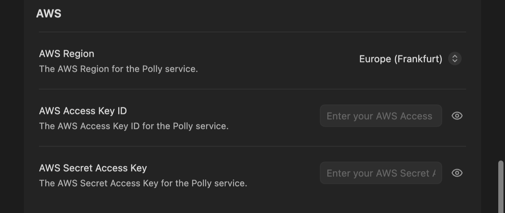

<!-- guide:header -->

[🏠 User Guide](https://github.com/chrisurf/obsidian-voice/blob/main/docs/README.md) · [Getting started](https://github.com/chrisurf/obsidian-voice/blob/main/docs/getting-started/README.md) · **[Providers](https://github.com/chrisurf/obsidian-voice/blob/main/docs/providers/README.md)** · [Using Voice](https://github.com/chrisurf/obsidian-voice/blob/main/docs/using-voice/README.md) · [Customizing](https://github.com/chrisurf/obsidian-voice/blob/main/docs/customizing/README.md) · [Help](https://github.com/chrisurf/obsidian-voice/blob/main/docs/help/README.md)

📍 [User Guide](https://github.com/chrisurf/obsidian-voice/blob/main/docs/README.md) › [Providers](https://github.com/chrisurf/obsidian-voice/blob/main/docs/providers/README.md) › **AWS Polly**

<!-- /guide:header -->

# AWS Polly

Amazon Polly offers natural neural voices in many languages and supports SSML, so headings and emphasis get real pauses and stress.



## Set it up

1. **Create an AWS account** at [aws.amazon.com](https://aws.amazon.com/) if you don't have one. The free tier includes one million neural characters per month for the first 12 months.
2. **Create a dedicated access key** (recommended, see below) and copy the **Access Key ID** and **Secret Access Key**.
3. In **Settings → Voice**, choose **AWS Polly** in **Speech provider**.
4. Choose the **AWS Region** closest to you — for example _Europe (Frankfurt)_ — for faster responses.
5. Paste both keys and select **Test Credentials**.

## A dedicated key with minimal rights

Don't use your main AWS credentials. Create a user that can only read text aloud:

1. In the AWS console, open **IAM → Users → Create user**, for example `obsidian-voice`.
2. Give it permissions in one of two ways:
   - **Fastest:** attach the policy **AmazonPollyReadOnlyAccess**.
   - **Minimal:** create a policy with this JSON and attach it:

     ```json
     {
       "Version": "2012-10-17",
       "Statement": [
         {
           "Effect": "Allow",
           "Action": ["polly:SynthesizeSpeech", "polly:DescribeVoices"],
           "Resource": "*"
         }
       ]
     }
     ```

3. Open the user's **Security credentials**, create an **access key** (use case: _Application running outside AWS_) and copy both values. The secret is shown only once.

When you rotate the key later, just paste the new one in settings.

## Good to know

- The voice list shows the voices available in your region. Pick one that matches your note's language.
- Polly reads headings, emphasis and pauses natively (SSML). How acronyms and lists are read is set in your [speech profile](https://github.com/chrisurf/obsidian-voice/blob/main/docs/customizing/speech-profiles.md).

<!-- guide:footer -->

---

<table><tr>
<td align="left">← Previous<br><a href="https://github.com/chrisurf/obsidian-voice/blob/main/docs/providers/README.md"><b>Providers</b></a></td>
<td align="right">Next →<br><a href="https://github.com/chrisurf/obsidian-voice/blob/main/docs/providers/elevenlabs.md"><b>ElevenLabs</b></a></td>
</tr></table>

<!-- /guide:footer -->
