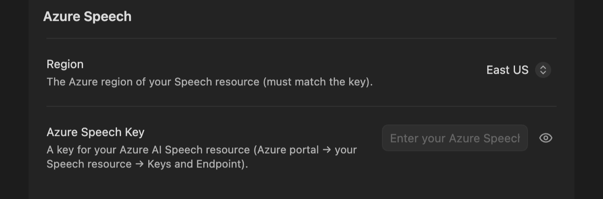

<!-- guide:header -->

[🏠 User Guide](https://github.com/chrisurf/obsidian-voice/blob/main/docs/README.md) · [Getting started](https://github.com/chrisurf/obsidian-voice/blob/main/docs/getting-started/README.md) · **[Providers](https://github.com/chrisurf/obsidian-voice/blob/main/docs/providers/README.md)** · [Using Voice](https://github.com/chrisurf/obsidian-voice/blob/main/docs/using-voice/README.md) · [Customizing](https://github.com/chrisurf/obsidian-voice/blob/main/docs/customizing/README.md) · [Help](https://github.com/chrisurf/obsidian-voice/blob/main/docs/help/README.md)

📍 [User Guide](https://github.com/chrisurf/obsidian-voice/blob/main/docs/README.md) › [Providers](https://github.com/chrisurf/obsidian-voice/blob/main/docs/providers/README.md) › **Azure Speech**

<!-- /guide:header -->

# Azure Speech

Microsoft Azure's Speech service offers hundreds of neural voices. Voice loads the full list from your account, grouped by language.

## Set it up

1. In the [Azure portal](https://portal.azure.com/), create a **Speech** resource (search for _Speech services_).
2. Open the resource → **Keys and Endpoint**. Copy **Key 1** and note the **Location/Region**, for example `westeurope`.
3. In **Settings → Voice**, choose **Azure Speech** in **Speech provider**.
4. Choose the same **Region** as your resource — the key only works there.
5. Paste the key and select **Test Credentials**. Voice now loads every voice your account offers.
6. Choose a voice in the player; the list is grouped by language.

## Good to know

- Select **Test Credentials** again later to refresh the voice list.
- Azure reads headings, emphasis and pauses natively (SSML).

<!-- guide:footer -->

---

<table><tr>
<td align="left">← Previous <a href="https://github.com/chrisurf/obsidian-voice/blob/main/docs/providers/google-cloud.md"><b>Google Cloud</b></a></td>
<td align="right">Next → <a href="https://github.com/chrisurf/obsidian-voice/blob/main/docs/providers/minimax.md"><b>MiniMax</b></a></td>
</tr></table>

<!-- /guide:footer -->
