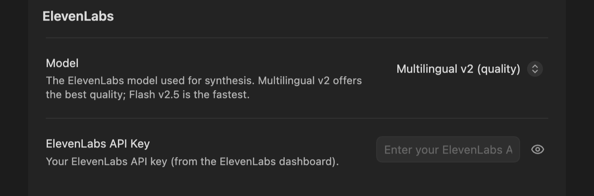

<!-- guide:header -->

[🏠 User Guide](https://github.com/chrisurf/obsidian-voice/blob/main/docs/README.md) · [Getting started](https://github.com/chrisurf/obsidian-voice/blob/main/docs/getting-started/README.md) · **[Providers](https://github.com/chrisurf/obsidian-voice/blob/main/docs/providers/README.md)** · [Using Voice](https://github.com/chrisurf/obsidian-voice/blob/main/docs/using-voice/README.md) · [Customizing](https://github.com/chrisurf/obsidian-voice/blob/main/docs/customizing/README.md) · [Help](https://github.com/chrisurf/obsidian-voice/blob/main/docs/help/README.md)

📍 [User Guide](https://github.com/chrisurf/obsidian-voice/blob/main/docs/README.md) › [Providers](https://github.com/chrisurf/obsidian-voice/blob/main/docs/providers/README.md) › **ElevenLabs**

<!-- /guide:header -->

# ElevenLabs

ElevenLabs is known for expressive, very natural voices in 29 languages.

## Set it up

1. Sign in at [elevenlabs.io](https://elevenlabs.io/).
2. Open your profile → **API Keys** and create a key. Copy it.
3. In **Settings → Voice**, choose **ElevenLabs** in **Speech provider**.
4. Pick a **Model**:
   - **Multilingual v2** — the best quality.
   - **Flash v2.5** — the fastest.
   - **Turbo v2.5** — a balance of both.
5. Paste the key and select **Test Credentials**.
6. Choose a voice in the player.

## Good to know

- ElevenLabs bills by characters; long notes use up your quota quickly. Save readings you want to keep, so you never generate them twice.
- Natural pauses between sections are added automatically.

<!-- guide:footer -->

---

<table><tr>
<td align="left">← Previous <a href="https://github.com/chrisurf/obsidian-voice/blob/main/docs/providers/aws-polly.md"><b>AWS Polly</b></a></td>
<td align="right">Next → <a href="https://github.com/chrisurf/obsidian-voice/blob/main/docs/providers/openai.md"><b>OpenAI</b></a></td>
</tr></table>

<!-- /guide:footer -->
