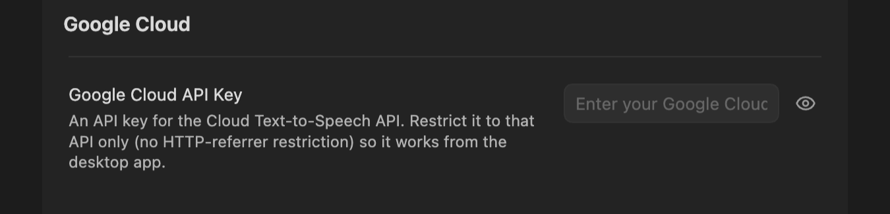

<!-- guide:header -->

[🏠 User Guide](https://github.com/chrisurf/obsidian-voice/blob/main/docs/README.md) · [Getting started](https://github.com/chrisurf/obsidian-voice/blob/main/docs/getting-started/README.md) · **[Providers](https://github.com/chrisurf/obsidian-voice/blob/main/docs/providers/README.md)** · [Using Voice](https://github.com/chrisurf/obsidian-voice/blob/main/docs/using-voice/README.md) · [Customizing](https://github.com/chrisurf/obsidian-voice/blob/main/docs/customizing/README.md) · [Help](https://github.com/chrisurf/obsidian-voice/blob/main/docs/help/README.md)

📍 [User Guide](https://github.com/chrisurf/obsidian-voice/blob/main/docs/README.md) › [Providers](https://github.com/chrisurf/obsidian-voice/blob/main/docs/providers/README.md) › **Google Cloud**

<!-- /guide:header -->

# Google Cloud

Google Cloud Text-to-Speech offers Neural2 and WaveNet voices in many languages, with native support for pauses and emphasis (SSML).

## Set it up

1. Open the [Google Cloud console](https://console.cloud.google.com/) and select or create a project with billing turned on.
2. Enable the **Cloud Text-to-Speech API** (search for it under **APIs & Services → Library**).
3. Under **APIs & Services → Credentials**, select **Create credentials → API key**.
4. **Restrict the key** to the Cloud Text-to-Speech API. Don't add an _HTTP referrer_ restriction — it blocks the Obsidian app.
5. In **Settings → Voice**, choose **Google Cloud** in **Speech provider**, paste the key and select **Test Credentials**.
6. Choose a voice in the player.

## Good to know

- If the key is rejected, check that the API is enabled, billing is active, and there is no referrer restriction.
- Neural2 voices sound more natural; WaveNet voices cover more languages.

<!-- guide:footer -->

---

<table><tr>
<td align="left">← Previous <a href="https://github.com/chrisurf/obsidian-voice/blob/main/docs/providers/openai.md"><b>OpenAI</b></a></td>
<td align="right">Next → <a href="https://github.com/chrisurf/obsidian-voice/blob/main/docs/providers/azure-speech.md"><b>Azure Speech</b></a></td>
</tr></table>

<!-- /guide:footer -->
