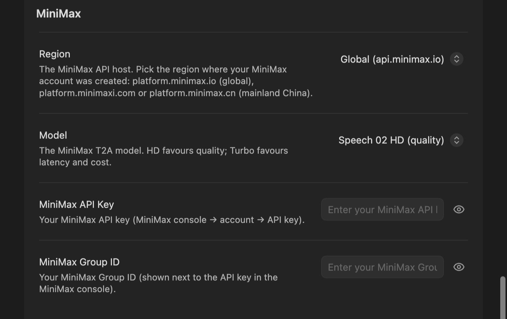

<!-- guide:header -->

[🏠 User Guide](https://github.com/chrisurf/obsidian-voice/blob/main/docs/README.md) · [Getting started](https://github.com/chrisurf/obsidian-voice/blob/main/docs/getting-started/README.md) · **[Providers](https://github.com/chrisurf/obsidian-voice/blob/main/docs/providers/README.md)** · [Using Voice](https://github.com/chrisurf/obsidian-voice/blob/main/docs/using-voice/README.md) · [Customizing](https://github.com/chrisurf/obsidian-voice/blob/main/docs/customizing/README.md) · [Help](https://github.com/chrisurf/obsidian-voice/blob/main/docs/help/README.md)

📍 [User Guide](https://github.com/chrisurf/obsidian-voice/blob/main/docs/README.md) › [Providers](https://github.com/chrisurf/obsidian-voice/blob/main/docs/providers/README.md) › **MiniMax**

<!-- /guide:header -->

# MiniMax

MiniMax offers multilingual voices with particularly strong Chinese support, and a region for accounts created in mainland China.

## Set it up

1. Sign in to the MiniMax platform where your account was created:
   - [platform.minimax.io](https://platform.minimax.io/) (global)
   - [platform.minimaxi.com](https://platform.minimaxi.com/) (mainland China)
2. Copy your **API key** and your **Group ID** (shown next to the key in the console).
3. In **Settings → Voice**, choose **MiniMax** in **Speech provider**.
4. Choose the **Region** that matches your account.
5. Pick a **Model**: _HD_ models favor quality, _Turbo_ models speed and cost.
6. Paste the key and Group ID and select **Test Credentials**.

## Good to know

- A key only works in the region where the account was created. If the test fails, try the other region.

<!-- guide:footer -->

---

<table><tr>
<td align="left">← Previous <a href="https://github.com/chrisurf/obsidian-voice/blob/main/docs/providers/azure-speech.md"><b>Azure Speech</b></a></td>
<td align="right">Next → <a href="https://github.com/chrisurf/obsidian-voice/blob/main/docs/providers/openai-compatible.md"><b>OpenAI-compatible servers</b></a></td>
</tr></table>

<!-- /guide:footer -->
