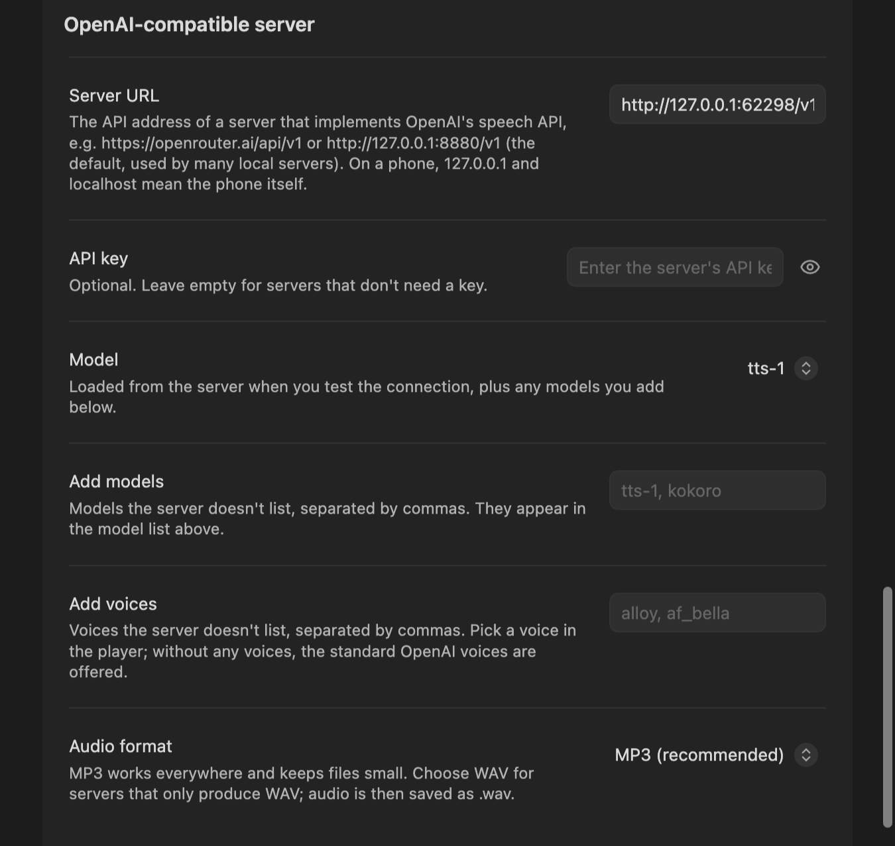

<!-- guide:header -->

[🏠 User Guide](https://github.com/chrisurf/obsidian-voice/blob/main/docs/README.md) · [Getting started](https://github.com/chrisurf/obsidian-voice/blob/main/docs/getting-started/README.md) · **[Providers](https://github.com/chrisurf/obsidian-voice/blob/main/docs/providers/README.md)** · [Using Voice](https://github.com/chrisurf/obsidian-voice/blob/main/docs/using-voice/README.md) · [Customizing](https://github.com/chrisurf/obsidian-voice/blob/main/docs/customizing/README.md) · [Help](https://github.com/chrisurf/obsidian-voice/blob/main/docs/help/README.md)

📍 [User Guide](https://github.com/chrisurf/obsidian-voice/blob/main/docs/README.md) › [Providers](https://github.com/chrisurf/obsidian-voice/blob/main/docs/providers/README.md) › **OpenAI-compatible servers**

<!-- /guide:header -->

# OpenAI-compatible servers

Many services and self-hosted servers offer the same speech API as OpenAI. With **OpenAI-compatible** you can use any of them — a hosted router such as OpenRouter, a proxy such as LiteLLM, or a free voice running on your own computer such as Kokoro.

## Set it up

1. In **Settings → Voice**, choose **OpenAI-compatible** in **Speech provider**.
2. Enter the **Server URL** — the address the API hangs off:

   | Server                                                             | Server URL                     |
   | ------------------------------------------------------------------ | ------------------------------ |
   | [OpenRouter](https://openrouter.ai/)                               | `https://openrouter.ai/api/v1` |
   | [Kokoro-FastAPI](https://github.com/remsky/Kokoro-FastAPI) (local) | `http://localhost:8880/v1`     |
   | [LiteLLM](https://docs.litellm.ai/) proxy (local)                  | `http://localhost:4000/v1`     |

   The field starts with `http://127.0.0.1:8880/v1`, which many local servers use. Voice adds `/audio/speech` and `/models` to the address.

3. Paste an **API key** if the server needs one (OpenRouter does; most local servers don't).
4. Select **Test Credentials**. Voice loads the server's models and, where available, its voices.
5. Pick a **Model**. Missing a model or voice? Type it into **Add models** or **Add voices**, separated by commas. Without any voices, the standard OpenAI voices are offered.
6. Choose the voice in the player.

## Audio format

**MP3** is the default and works everywhere — use it whenever you can. Choose **WAV** only for servers that can't produce MP3. WAV files are larger, can't hold [bookmarks](https://github.com/chrisurf/obsidian-voice/blob/main/docs/using-voice/bookmarks.md), and play only once complete.

## Security

- Prefer `https://` with a real certificate (for example from Let's Encrypt or Tailscale). Self-signed certificates don't work.
- Plain `http://` sends your notes unencrypted. Use it only on a network you trust — iPhone and iPad may block it.

## On mobile

On a phone, `localhost` means the phone itself. To reach a server on your computer, use the computer's network address (for example `http://192.168.1.20:8880/v1`) or a hosted HTTPS address.

<!-- guide:footer -->

---

<table><tr>
<td align="left">← Previous <a href="https://github.com/chrisurf/obsidian-voice/blob/main/docs/providers/minimax.md"><b>MiniMax</b></a></td>
<td align="right">Next → <a href="https://github.com/chrisurf/obsidian-voice/blob/main/docs/using-voice/README.md"><b>Using Voice</b></a></td>
</tr></table>

<!-- /guide:footer -->
