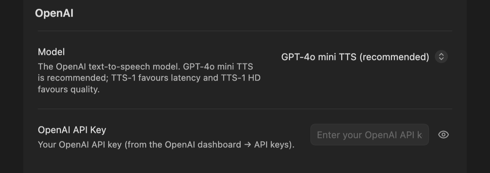

<!-- guide:header -->

[🏠 User Guide](https://github.com/chrisurf/obsidian-voice/blob/main/docs/README.md) · [Getting started](https://github.com/chrisurf/obsidian-voice/blob/main/docs/getting-started/README.md) · **[Providers](https://github.com/chrisurf/obsidian-voice/blob/main/docs/providers/README.md)** · [Using Voice](https://github.com/chrisurf/obsidian-voice/blob/main/docs/using-voice/README.md) · [Customizing](https://github.com/chrisurf/obsidian-voice/blob/main/docs/customizing/README.md) · [Help](https://github.com/chrisurf/obsidian-voice/blob/main/docs/help/README.md)

📍 [User Guide](https://github.com/chrisurf/obsidian-voice/blob/main/docs/README.md) › [Providers](https://github.com/chrisurf/obsidian-voice/blob/main/docs/providers/README.md) › **OpenAI**

<!-- /guide:header -->

# OpenAI

OpenAI's speech models offer natural, multilingual voices such as Alloy, Nova and Shimmer — a great choice if you already have an OpenAI account.

## Set it up

1. Create an API key at [platform.openai.com/api-keys](https://platform.openai.com/api-keys) and copy it.
2. Make sure your OpenAI account has billing set up — the speech API is paid.
3. In **Settings → Voice**, choose **OpenAI** in **Speech provider**.
4. Pick a **Model**:
   - **GPT-4o mini TTS** (recommended) — natural and affordable.
   - **TTS-1** — the fastest.
   - **TTS-1 HD** — the highest quality.
5. Paste the key and select **Test Credentials**.
6. Choose a voice in the player.

## Good to know

- Every OpenAI voice speaks many languages; it follows the language of your note.
- Want to use a different server that speaks the same API — such as OpenRouter or a voice on your own computer? Use [OpenAI-compatible servers](https://github.com/chrisurf/obsidian-voice/blob/main/docs/providers/openai-compatible.md) instead; both keep their own settings.

<!-- guide:footer -->

---

<table><tr>
<td align="left">← Previous <a href="https://github.com/chrisurf/obsidian-voice/blob/main/docs/providers/elevenlabs.md"><b>ElevenLabs</b></a></td>
<td align="right">Next → <a href="https://github.com/chrisurf/obsidian-voice/blob/main/docs/providers/google-cloud.md"><b>Google Cloud</b></a></td>
</tr></table>

<!-- /guide:footer -->
