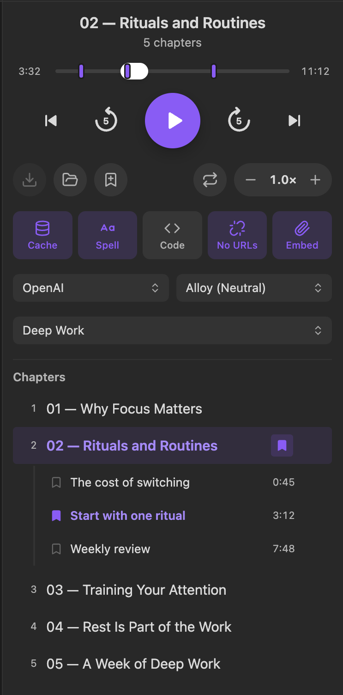
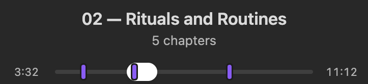
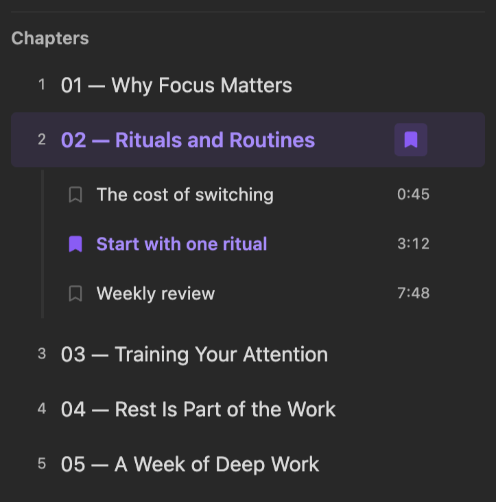
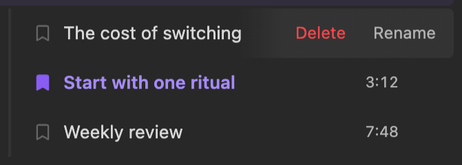
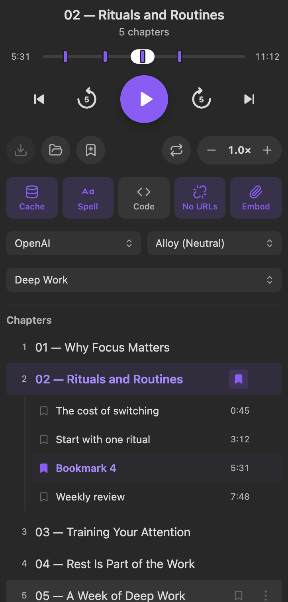

<!-- guide:header -->

[🏠 User Guide](https://github.com/chrisurf/obsidian-voice/blob/main/docs/README.md) · [Getting started](https://github.com/chrisurf/obsidian-voice/blob/main/docs/getting-started/README.md) · [Providers](https://github.com/chrisurf/obsidian-voice/blob/main/docs/providers/README.md) · **[Using Voice](https://github.com/chrisurf/obsidian-voice/blob/main/docs/using-voice/README.md)** · [Customizing](https://github.com/chrisurf/obsidian-voice/blob/main/docs/customizing/README.md) · [Help](https://github.com/chrisurf/obsidian-voice/blob/main/docs/help/README.md)

📍 [User Guide](https://github.com/chrisurf/obsidian-voice/blob/main/docs/README.md) › [Using Voice](https://github.com/chrisurf/obsidian-voice/blob/main/docs/using-voice/README.md) › **Bookmarks**

<!-- /guide:header -->

# Bookmarks

Mark the spots you want to come back to — a key idea, an example, where you stopped — and jump back with one tap.

## Add a bookmark

While audio plays, select 🔖 in the player, or run _Add a bookmark at the current position._ — ideal for a [hotkey](https://github.com/chrisurf/obsidian-voice/blob/main/docs/customizing/shortcuts.md).

A notice confirms it with the name and the position. Select **Rename** to name it right away, or **Undo** if it was a mistake:

New bookmarks are called _Bookmark 1_, _Bookmark 2_, … Tapping twice at almost the same spot doesn't create a second one.

## Find your bookmarks

**On the seek bar** every bookmark is a small mark. Tap it to jump there.

**Below the chapter:** select the 🔖 icon next to a chapter's **⋮** (or **⋮ → Bookmarks**). The list opens below the chapter, with the name on the left and the position on the right. The icon is filled when a file has bookmarks. The bookmark you passed last is highlighted.

Tap a bookmark to play from there — even when another chapter is playing.

## Rename or delete

Select **⋮** next to a bookmark:

- **Rename** — edit the name in place, then press Enter.
- **Delete** — removes it; a notice lets you **Undo**.

## Stored in the MP3 itself

Bookmarks are saved **inside the audio file**, as standard chapter marks. They travel with the file — when you sync, copy or share it — and podcast apps such as Apple Podcasts or Overcast show them as chapters.

- Voice writes the file a moment after your last change, but **never while it plays**: it waits until you pause or switch chapters. Nothing is lost if Obsidian closes first.
- Bookmarks set while listening to a reading you haven't saved yet are written into the MP3 when you save it.

## Good to know

- Bookmarks need MP3 files; WAV files can't hold them.
- Audio saved with Voice versions before 1.21 is repaired the first time you open its bookmarks, so they work on iPhone and iPad too.

<!-- guide:footer -->

---

<table><tr>
<td align="left">← Previous <a href="https://github.com/chrisurf/obsidian-voice/blob/main/docs/using-voice/chapters.md"><b>Chapters</b></a></td>
<td align="right">Next → <a href="https://github.com/chrisurf/obsidian-voice/blob/main/docs/using-voice/saving-audio.md"><b>Saving audio</b></a></td>
</tr></table>

<!-- /guide:footer -->
