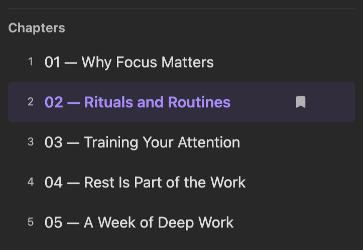
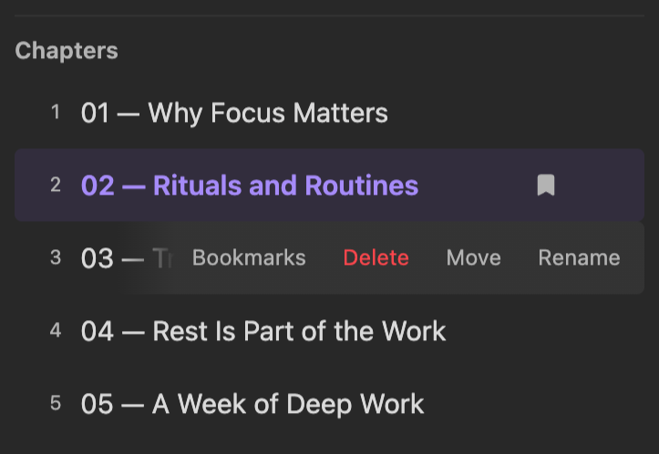
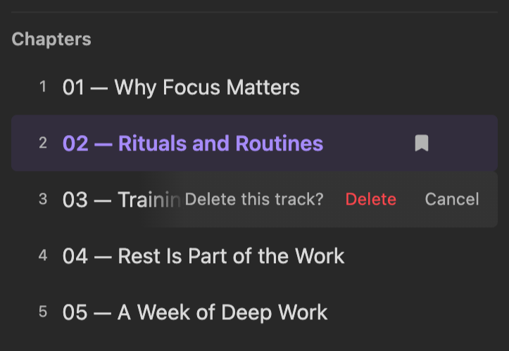
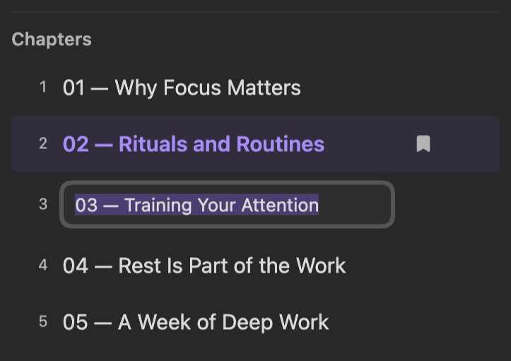

<!-- guide:header -->

[🏠 User Guide](https://github.com/chrisurf/obsidian-voice/blob/main/docs/README.md) · [Getting started](https://github.com/chrisurf/obsidian-voice/blob/main/docs/getting-started/README.md) · [Providers](https://github.com/chrisurf/obsidian-voice/blob/main/docs/providers/README.md) · **[Using Voice](https://github.com/chrisurf/obsidian-voice/blob/main/docs/using-voice/README.md)** · [Customizing](https://github.com/chrisurf/obsidian-voice/blob/main/docs/customizing/README.md) · [Help](https://github.com/chrisurf/obsidian-voice/blob/main/docs/help/README.md)

📍 [User Guide](https://github.com/chrisurf/obsidian-voice/blob/main/docs/README.md) › [Using Voice](https://github.com/chrisurf/obsidian-voice/blob/main/docs/using-voice/README.md) › **Chapters**

<!-- /guide:header -->

# Chapters

The player lists every audio file of a folder as a **chapter**, like the tracks of an audiobook. Save a few readings into one folder and you have your own playlist.

## Choose the folder

The **folder** picker above the list chooses which folder's audio appears. By default it follows the note you are viewing. To keep your chosen folder while you browse other notes, turn off **Folder list follows note** in **Settings → Voice → Player**.

## Play a chapter

Tap a chapter to play it. The one playing is highlighted and shown in the player's title. ⏮ and ⏭ move to the previous and next chapter, and 🔁 can repeat one or all of them.

## Manage a chapter

Select **⋮** on a chapter. A small bar appears right over that row, so it's clear which file it acts on:

- **Bookmarks** — show the chapter's [bookmarks](https://github.com/chrisurf/obsidian-voice/blob/main/docs/using-voice/bookmarks.md) (the 🔖 icon next to ⋮ does the same).
- **Delete** — asks first, then moves the file to the trash:

  

- **Move** — opens the folder picker and moves the file there. Links and embeds of the file are updated.
- **Rename** — edit the name right in the list; press Enter to save or Escape to cancel. The `.mp3` ending stays, and embeds are updated.

  

## Good to know

- MP3 and WAV files both appear as chapters.
- Chapters are ordered by name. Start names with a number (`01 — …`, `02 — …`) to control the order.

<!-- guide:footer -->

---

<table><tr>
<td align="left">← Previous <a href="https://github.com/chrisurf/obsidian-voice/blob/main/docs/using-voice/playback-controls.md"><b>Speed, skipping and repeat</b></a></td>
<td align="right">Next → <a href="https://github.com/chrisurf/obsidian-voice/blob/main/docs/using-voice/bookmarks.md"><b>Bookmarks</b></a></td>
</tr></table>

<!-- /guide:footer -->
