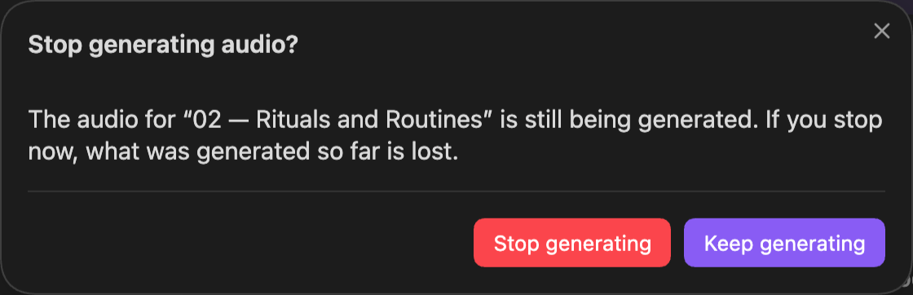

<!-- guide:header -->

[🏠 User Guide](https://github.com/chrisurf/obsidian-voice/blob/main/docs/README.md) · [Getting started](https://github.com/chrisurf/obsidian-voice/blob/main/docs/getting-started/README.md) · [Providers](https://github.com/chrisurf/obsidian-voice/blob/main/docs/providers/README.md) · **[Using Voice](https://github.com/chrisurf/obsidian-voice/blob/main/docs/using-voice/README.md)** · [Customizing](https://github.com/chrisurf/obsidian-voice/blob/main/docs/customizing/README.md) · [Help](https://github.com/chrisurf/obsidian-voice/blob/main/docs/help/README.md)

📍 [User Guide](https://github.com/chrisurf/obsidian-voice/blob/main/docs/README.md) › [Using Voice](https://github.com/chrisurf/obsidian-voice/blob/main/docs/using-voice/README.md) › **Reading notes aloud**

<!-- /guide:header -->

# Reading notes aloud

## Start reading

Open a note, then use any of these:

- the ▶️ **Voice read text** icon in the left ribbon,
- the big ▶️ button in the player,
- the command _Start reading the current document._ (or _Play or Stop reading the current document._ for one key that does both).

**Only part of a note:** in editing mode, select the text first. Voice reads just the selection.

**What Voice reads:** the text of your note, with headings, lists and paragraphs turned into natural pauses. Front matter and formatting symbols are left out; web addresses are skipped and code blocks replaced by a placeholder unless you turn on **Code**. How acronyms, abbreviations and numbered lists sound is set per language in your [speech profile](https://github.com/chrisurf/obsidian-voice/blob/main/docs/customizing/speech-profiles.md).

## Long notes start early

Voice generates long notes in parts and **starts playing before the whole note is done**. The ring around ▶️ keeps filling while you listen:

- Voice works out when to start: right away with a fast provider, a little later with a slower one, so playback never catches up with the generating. It measures each provider's speed after every long note.
- Can't wait? Tap ▶️ before it starts to hear what is ready right away.
- Tap ▶️ to pause and resume — generating continues in the background.

Playing early works with MP3 on desktop, iPad and iPhone (iOS 17.1 or later). With WAV, or where it isn't supported, the audio plays once it is complete. You can turn it off or set the start point yourself in [Settings](https://github.com/chrisurf/obsidian-voice/blob/main/docs/customizing/settings.md).

## Generating always finishes

Pausing, stopping, opening another note or tapping a chapter never interrupts generating — you'd lose audio you already paid for. Voice tells you the note is still being generated instead.

To really stop it, select the red **✕** next to the progress bar — in the player, the status bar or the mobile control bar — or run _Stop generating audio (asks first)._ Voice asks before it throws the audio away:

## Cache: never pay twice by accident

Generating speech costs money with most providers. The **Cache** toggle in the player makes sure you only pay once:

- **Cache on** (default): ▶️ plays the note's **existing audio** — its saved MP3, or the audio already generated in this session. It generates only when there is none yet. Changing the voice or a toggle doesn't generate anything on its own.
- **Cache off:** the next ▶️ **generates the note again** with your current voice and settings. Afterwards Cache switches itself back on.

So to hear a note with a new voice: turn **Cache** off, then press ▶️.

<!-- guide:footer -->

---

<table><tr>
<td align="left">← Previous <a href="https://github.com/chrisurf/obsidian-voice/blob/main/docs/using-voice/player.md"><b>The Voice player</b></a></td>
<td align="right">Next → <a href="https://github.com/chrisurf/obsidian-voice/blob/main/docs/using-voice/playback-controls.md"><b>Speed, skipping and repeat</b></a></td>
</tr></table>

<!-- /guide:footer -->
