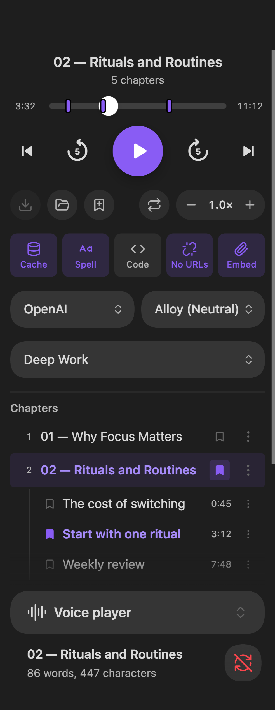
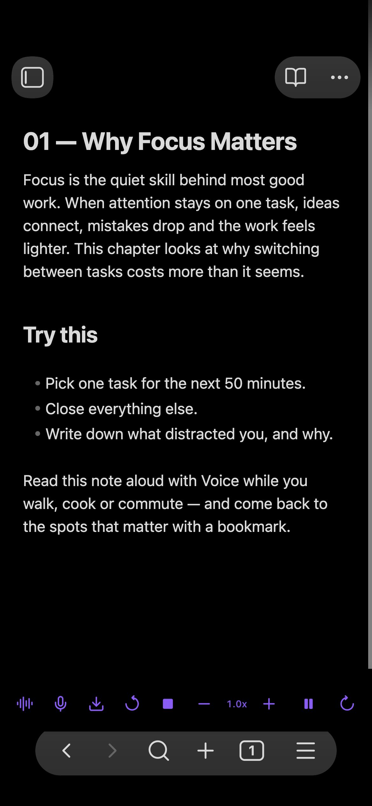
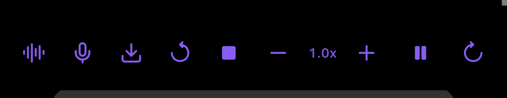

<!-- guide:header -->

[🏠 User Guide](https://github.com/chrisurf/obsidian-voice/blob/main/docs/README.md) · [Getting started](https://github.com/chrisurf/obsidian-voice/blob/main/docs/getting-started/README.md) · [Providers](https://github.com/chrisurf/obsidian-voice/blob/main/docs/providers/README.md) · **[Using Voice](https://github.com/chrisurf/obsidian-voice/blob/main/docs/using-voice/README.md)** · [Customizing](https://github.com/chrisurf/obsidian-voice/blob/main/docs/customizing/README.md) · [Help](https://github.com/chrisurf/obsidian-voice/blob/main/docs/help/README.md)

📍 [User Guide](https://github.com/chrisurf/obsidian-voice/blob/main/docs/README.md) › [Using Voice](https://github.com/chrisurf/obsidian-voice/blob/main/docs/using-voice/README.md) › **On iPhone, iPad and Android**

<!-- /guide:header -->

# On iPhone, iPad and Android

Voice works the same on mobile as on desktop — with controls made for touch.

## The player

Open it from the ribbon menu (**Open Voice player**) or the command _Open the player._ It opens full screen, with all the controls of the desktop player:

Everything in [The Voice player](https://github.com/chrisurf/obsidian-voice/blob/main/docs/using-voice/player.md) applies: chapters, bookmarks, toggles, speed and saving. On touch screens, the 🔖 and ⋮ icons of each chapter are always shown.

## The control bar

When you start reading from a note and the player isn't open, a control bar appears at the bottom of the screen:

From left to right: open the player, switch the voice, save, back, stop, slower, the speed, faster, play/pause and ahead. While a note is generated, a progress bar with a red **✕** appears above it. The bar steps aside while the full player is open.

## Start reading

Open the ribbon menu and select **Voice read text**, or use the player's ▶️.

## Good to know

- **Playing early** while a long note is generated needs iOS 17.1 or later on iPhone.
- **A server on your computer** isn't reachable as `localhost` from your phone; see [OpenAI-compatible servers](https://github.com/chrisurf/obsidian-voice/blob/main/docs/providers/openai-compatible.md#on-mobile).

<!-- guide:footer -->

---

<table><tr>
<td align="left">← Previous <a href="https://github.com/chrisurf/obsidian-voice/blob/main/docs/using-voice/status-bar.md"><b>Status bar controls</b></a></td>
<td align="right">Next → <a href="https://github.com/chrisurf/obsidian-voice/blob/main/docs/customizing/README.md"><b>Customizing</b></a></td>
</tr></table>

<!-- /guide:footer -->
