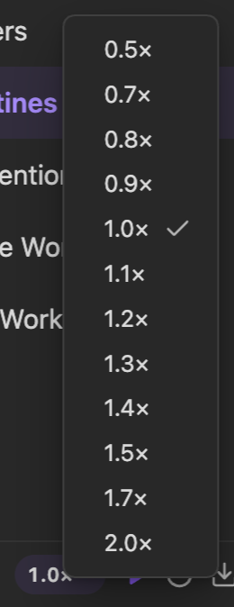

<!-- guide:header -->

[🏠 User Guide](https://github.com/chrisurf/obsidian-voice/blob/main/docs/README.md) · [Getting started](https://github.com/chrisurf/obsidian-voice/blob/main/docs/getting-started/README.md) · [Providers](https://github.com/chrisurf/obsidian-voice/blob/main/docs/providers/README.md) · **[Using Voice](https://github.com/chrisurf/obsidian-voice/blob/main/docs/using-voice/README.md)** · [Customizing](https://github.com/chrisurf/obsidian-voice/blob/main/docs/customizing/README.md) · [Help](https://github.com/chrisurf/obsidian-voice/blob/main/docs/help/README.md)

📍 [User Guide](https://github.com/chrisurf/obsidian-voice/blob/main/docs/README.md) › [Using Voice](https://github.com/chrisurf/obsidian-voice/blob/main/docs/using-voice/README.md) › **Speed, skipping and repeat**

<!-- /guide:header -->

# Speed, skipping and repeat

## Speed

Change the tempo while you listen, from **0.5×** to **2.0×**:

- In the player, use **−** and **+** next to the speed.
- In the status bar (desktop), click the speed and pick one from the list:

  

- With commands, which you can give [hotkeys](https://github.com/chrisurf/obsidian-voice/blob/main/docs/customizing/shortcuts.md): _Increase / Decrease the reading speed by 0.1x_, or jump to 0.75×, 0.85×, 1.15× or 1.25×.

The speed applies right away and is remembered.

## Jump back or ahead

↺ and ↻ jump back and ahead by **5 seconds**. The number inside the arrow shows the interval. Set each between 1 and 60 seconds in **Settings → Voice → Playback**.

## Jump anywhere

Drag the seek bar, or tap a [bookmark](https://github.com/chrisurf/obsidian-voice/blob/main/docs/using-voice/bookmarks.md) mark on it.

## Previous and next chapter

⏮ and ⏭ move through the [chapters](https://github.com/chrisurf/obsidian-voice/blob/main/docs/using-voice/chapters.md) of the folder shown in the player.

## Repeat

🔁 cycles through three modes:

1. **Off** — playback stops at the end of the chapter.
2. **Repeat one** — the chapter plays again and again.
3. **Repeat all** — when a chapter ends, the next one starts; after the last, the first.

<!-- guide:footer -->

---

<table><tr>
<td align="left">← Previous <a href="https://github.com/chrisurf/obsidian-voice/blob/main/docs/using-voice/listening.md"><b>Reading notes aloud</b></a></td>
<td align="right">Next → <a href="https://github.com/chrisurf/obsidian-voice/blob/main/docs/using-voice/chapters.md"><b>Chapters</b></a></td>
</tr></table>

<!-- /guide:footer -->
