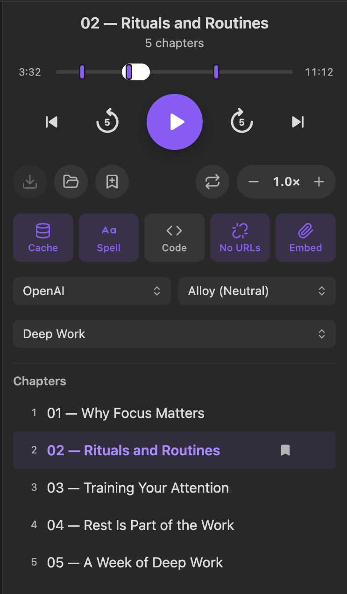
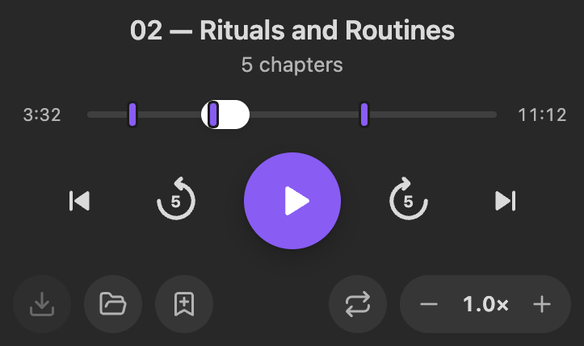
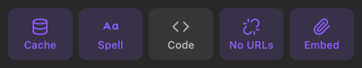
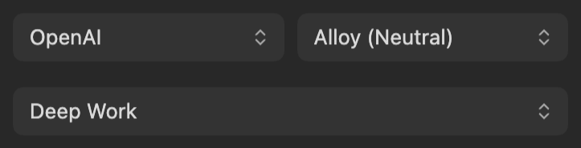

<!-- guide:header -->

[🏠 User Guide](https://github.com/chrisurf/obsidian-voice/blob/main/docs/README.md) · [Getting started](https://github.com/chrisurf/obsidian-voice/blob/main/docs/getting-started/README.md) · [Providers](https://github.com/chrisurf/obsidian-voice/blob/main/docs/providers/README.md) · **[Using Voice](https://github.com/chrisurf/obsidian-voice/blob/main/docs/using-voice/README.md)** · [Customizing](https://github.com/chrisurf/obsidian-voice/blob/main/docs/customizing/README.md) · [Help](https://github.com/chrisurf/obsidian-voice/blob/main/docs/help/README.md)

📍 [User Guide](https://github.com/chrisurf/obsidian-voice/blob/main/docs/README.md) › [Using Voice](https://github.com/chrisurf/obsidian-voice/blob/main/docs/using-voice/README.md) › **The Voice player**

<!-- /guide:header -->

# The Voice player

The Voice player is the heart of the plugin: an audiobook-style pane that plays your notes and lists your saved audio as chapters. On desktop it sits in the right sidebar; on mobile it opens full screen.

**Open it** with the waveform icon in the left ribbon, or the command _Open the player._

From top to bottom:

## Title and seek bar

The title shows what is playing — the note or the chapter — and how many chapters the folder holds. Drag the seek bar to jump anywhere; the times show the position and the length. Small marks on the bar are your [bookmarks](https://github.com/chrisurf/obsidian-voice/blob/main/docs/using-voice/bookmarks.md).

## Playback controls

| Control                   | What it does                                                          |
| ------------------------- | --------------------------------------------------------------------- |
| ▶️ **Play / pause**       | Reads the note you are viewing, or plays and pauses what is loaded    |
| ⏮ ⏭ **Previous / next** | Jump to the previous or next chapter                                  |
| ↺ ↻ **Back / ahead**      | Jump back or ahead by the number of seconds shown (5 by default)      |
| ⬇ **Save**                | Save the audio as an MP3. Hold it (or right-click) to choose a folder |
| 📂 **Folder**             | Save into a folder you pick                                           |
| 🔖 **Bookmark**           | Bookmark the spot you're hearing                                      |
| 🔁 **Repeat**             | Off → repeat this chapter → repeat all chapters                       |
| **− 1.0× +**              | Slower or faster, from 0.5× to 2.0×                                   |

Learn more in [Speed, skipping and repeat](https://github.com/chrisurf/obsidian-voice/blob/main/docs/using-voice/playback-controls.md) and [Saving audio](https://github.com/chrisurf/obsidian-voice/blob/main/docs/using-voice/saving-audio.md).

## Toggles

A row of switches that light up when on:

| Toggle      | When on                                                                | Default |
| ----------- | ---------------------------------------------------------------------- | ------- |
| **Cache**   | ▶️ reuses audio the note already has, instead of generating it again   | on      |
| **Spell**   | Acronyms such as `API` or `CEO` are read letter by letter              | on      |
| **Code**    | Code blocks are read aloud (otherwise Voice says a short placeholder)  | off     |
| **No URLs** | Web addresses are skipped; link text and the rest of the sentence stay | on      |
| **Embed**   | Saving an MP3 also adds an audio player to the note                    | off     |

**Cache** is explained in [Reading notes aloud](https://github.com/chrisurf/obsidian-voice/blob/main/docs/using-voice/listening.md#cache-never-pay-twice-by-accident). **Spell**, **Code** and **No URLs** are stored in your [speech profile](https://github.com/chrisurf/obsidian-voice/blob/main/docs/customizing/speech-profiles.md), so they can differ per language.

## Provider, voice and folder

- **Provider** and **voice** switch the engine and the voice instantly. See [Voices and languages](https://github.com/chrisurf/obsidian-voice/blob/main/docs/customizing/voices-and-languages.md).
- **Folder** chooses which folder's audio files appear as chapters. By default it follows the note you are viewing.

## Chapters

Every MP3 in the chosen folder is a chapter. Tap one to play it; the one playing is highlighted. The 🔖 icon opens its bookmarks and **⋮** moves, renames or deletes it. See [Chapters](https://github.com/chrisurf/obsidian-voice/blob/main/docs/using-voice/chapters.md).

## While a note is generated

A ring around ▶️ fills with the progress, and a bar with a red **✕** appears at the bottom of the player. See [Reading notes aloud](https://github.com/chrisurf/obsidian-voice/blob/main/docs/using-voice/listening.md).

<!-- guide:footer -->

---

<table><tr>
<td align="left">← Previous <a href="https://github.com/chrisurf/obsidian-voice/blob/main/docs/using-voice/README.md"><b>Using Voice</b></a></td>
<td align="right">Next → <a href="https://github.com/chrisurf/obsidian-voice/blob/main/docs/using-voice/listening.md"><b>Reading notes aloud</b></a></td>
</tr></table>

<!-- /guide:footer -->
