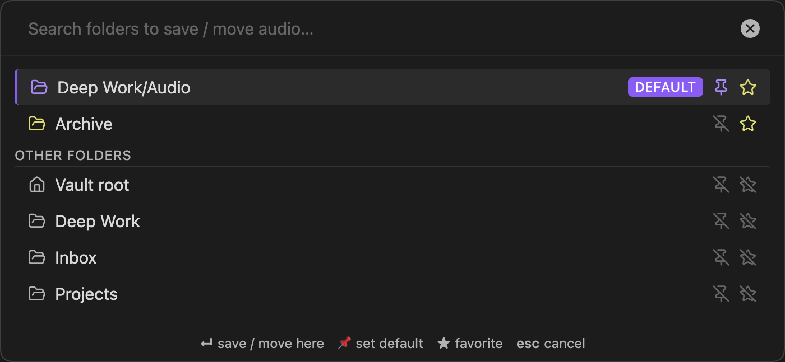
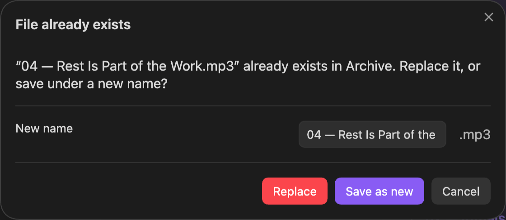
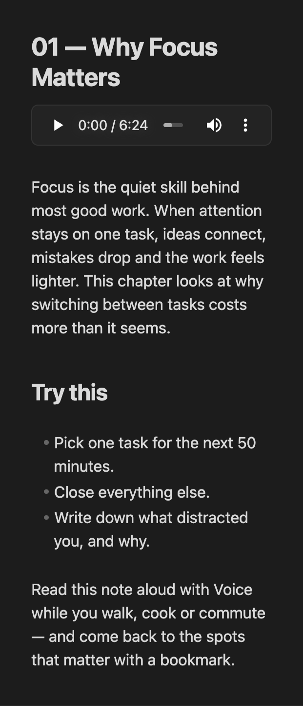

<!-- guide:header -->

[🏠 User Guide](https://github.com/chrisurf/obsidian-voice/blob/main/docs/README.md) · [Getting started](https://github.com/chrisurf/obsidian-voice/blob/main/docs/getting-started/README.md) · [Providers](https://github.com/chrisurf/obsidian-voice/blob/main/docs/providers/README.md) · **[Using Voice](https://github.com/chrisurf/obsidian-voice/blob/main/docs/using-voice/README.md)** · [Customizing](https://github.com/chrisurf/obsidian-voice/blob/main/docs/customizing/README.md) · [Help](https://github.com/chrisurf/obsidian-voice/blob/main/docs/help/README.md)

📍 [User Guide](https://github.com/chrisurf/obsidian-voice/blob/main/docs/README.md) › [Using Voice](https://github.com/chrisurf/obsidian-voice/blob/main/docs/using-voice/README.md) › **Saving audio**

<!-- /guide:header -->

# Saving audio

Save a reading as an MP3 and it's yours: listen again any time, offline, without paying for it again. Saved files appear as [chapters](https://github.com/chrisurf/obsidian-voice/blob/main/docs/using-voice/chapters.md) in the player.

## Save with one tap

Select **save** (⬇) — in the player, the status bar or the mobile control bar — or run _Save the current audio as an MP3 and embed it in the note._

By default the MP3 is saved **next to your note**, with the note's name.

## Choose a folder

- **Hold** the save button for about 1.5 seconds (or right-click it) to open the folder picker — for this one file.
- Or select the **folder** button (📂) next to it, which opens the picker straight away.

In the picker:

- Type to filter the folders — or to **create a new folder** on the spot.
- 📌 **Pin** a folder to make it your **default**. From then on, a simple tap on save always saves there. Tap the pin again to go back to "next to the note".
- ⭐ **Star** folders you use often; favorites stay at the top.

When a default folder is set, the save button shows a floppy disk (💾) instead of the arrow, so you can tell where a tap will save:

## Save or move

When you pick a folder for audio that is **already saved** — for example a chapter you are playing — Voice **moves** the file instead of saving a copy. Its links and embeds are updated.

If the folder already has a file with that name, Voice asks what to do:

- **Replace** the existing file,
- **Save as new** under the name you type, or
- **Cancel**.

## Embed the audio in the note

Turn on **Embed** in the player and every saved MP3 is also added to its note, right below the front matter, as an audio player:

## Save automatically

Turn on **Save automatically** in **Settings → Voice → Saving audio** to save every reading after it plays, without pressing save. It uses your default folder too.

<!-- guide:footer -->

---

<table><tr>
<td align="left">← Previous <a href="https://github.com/chrisurf/obsidian-voice/blob/main/docs/using-voice/bookmarks.md"><b>Bookmarks</b></a></td>
<td align="right">Next → <a href="https://github.com/chrisurf/obsidian-voice/blob/main/docs/using-voice/status-bar.md"><b>Status bar controls</b></a></td>
</tr></table>

<!-- /guide:footer -->
