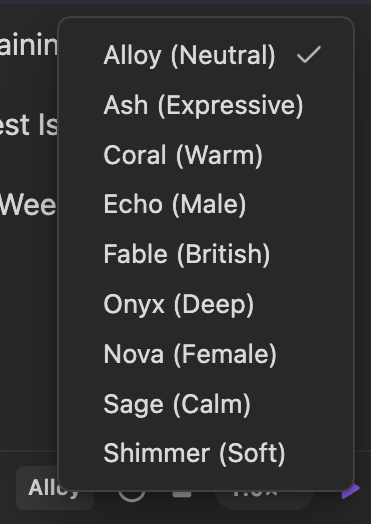
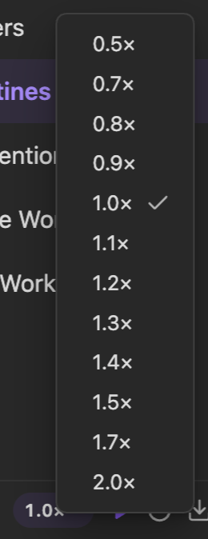

<!-- guide:header -->

[🏠 User Guide](https://github.com/chrisurf/obsidian-voice/blob/main/docs/README.md) · [Getting started](https://github.com/chrisurf/obsidian-voice/blob/main/docs/getting-started/README.md) · [Providers](https://github.com/chrisurf/obsidian-voice/blob/main/docs/providers/README.md) · **[Using Voice](https://github.com/chrisurf/obsidian-voice/blob/main/docs/using-voice/README.md)** · [Customizing](https://github.com/chrisurf/obsidian-voice/blob/main/docs/customizing/README.md) · [Help](https://github.com/chrisurf/obsidian-voice/blob/main/docs/help/README.md)

📍 [User Guide](https://github.com/chrisurf/obsidian-voice/blob/main/docs/README.md) › [Using Voice](https://github.com/chrisurf/obsidian-voice/blob/main/docs/using-voice/README.md) › **Status bar controls**

<!-- /guide:header -->

# Status bar controls

On desktop, Voice adds compact controls to the status bar at the bottom of the window, so you can control playback without opening the player.

From left to right:

| Control        | What it does                                          |
| -------------- | ----------------------------------------------------- |
| **Voice name** | Click to switch the voice                             |
| ↺              | Jump back                                             |
| ■              | Stop                                                  |
| **1.0× ⌃**     | Click to choose the speed                             |
| ▶️             | Play and pause                                        |
| ↻              | Jump ahead                                            |
| ⬇              | Save the audio (hold or right-click to pick a folder) |

## Switch the voice

## Choose the speed

## While a note is generated

A progress bar appears, with a red **✕** to stop generating (Voice asks first):

If something goes wrong — no connection, a wrong key — the bar turns red for a moment and a notice explains the problem. See [Troubleshooting](https://github.com/chrisurf/obsidian-voice/blob/main/docs/help/troubleshooting.md).

<!-- guide:footer -->

---

<table><tr>
<td align="left">← Previous <a href="https://github.com/chrisurf/obsidian-voice/blob/main/docs/using-voice/saving-audio.md"><b>Saving audio</b></a></td>
<td align="right">Next → <a href="https://github.com/chrisurf/obsidian-voice/blob/main/docs/using-voice/mobile.md"><b>On iPhone, iPad and Android</b></a></td>
</tr></table>

<!-- /guide:footer -->
